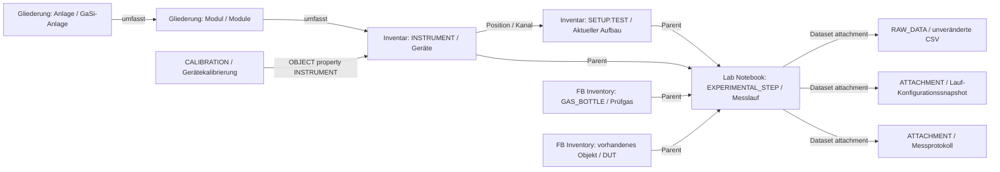
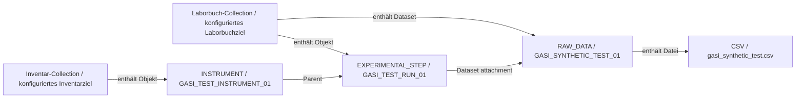

# GaSi-Datenmodell: aktueller Aufbau und Messlauf

Der Forschungsablauf, seine Entitäten, Ablage und Beziehungen sind im
[GaSi-Konzeptmodell nach den vier BAM-Schritten](GaSi_Konzeptmodell.md)
zusammengeführt. Die [HTML-Ansicht](GaSi_Konzeptmodell.html) zeigt einen Schritt
nach dem anderen. Dieses Dokument ergänzt die fachlichen Feldregeln und den
bisherigen Instanzbefund.

## Ziel und Beleggrenzen

Das Modell beschreibt **das aktuelle GaSi-Setup** der BAM, FB 8.1. Es ist kein in openBIS registriertes Schema. Frühere Gerätebestände und Umbauhistorien sind nicht Teil dieses Schritts. Ein Messlauf hält fest, welcher Aufbaustand bei seiner Aufnahme verwendet wurde.

Die Grundlage sind Wiki, Betriebscode, Loggerdateien und lokale Geräteunterlagen. Originalunterlagen, Seriennummern und gerätespezifische Befunde bleiben unter `data/datasheets/` beziehungsweise in der ignorierten `config/gasi_setup.json`. Die öffentliche Modellgrafik enthält diese Informationen nicht.

Die unten genannten Standardtypen wurden am 12.11.2026 lesend im Playground geprüft.
Der synthetische Testbereich und das Geräteinventar wurden anschließend im beauftragten
Umfang angelegt und geprüft. Das ist keine Freigabe einer Ablage echter Messläufe.
Ein sichtbarer Typ allein bestätigt weder Schreibrechte noch fachliche Eignung.
Die allgemeinen Anlagen-/Modulbeziehungen bleiben eine fachliche Gliederung.

## 1. Anlage, Module und Geräte

| Ebene | Bedeutung für GaSi | Was festgehalten wird |
|---|---|---|
| Anlage | Die gesamte Einrichtung | Name, Standort, Verantwortlichkeit und Übersicht |
| Modul | Zusammengehörige Baugruppe | Gasmischung, Befeuchter und Messkette |
| Gerät | Eine konkrete, einzeln identifizierbare Einheit | Hersteller, Modell, Serien-/Inventarkennung, Bereich, Unterlagen und Prüfmittelstatus |
| Aktuelles Setup | Die heutige Zuordnung dieser Geräte | Position, Aufgabe, Gasweg, Messort, Kanal und Verbindungseinstellungen |

Das Gasmischmodul umfasst die Positionen MFC 1–6. Der Befeuchter ergänzt zwei LDP-Regler und die Druckregelung. Die Messkette enthält die tatsächlich eingesetzten Referenzgeräte, Fühler, Prüflinge und die Erfassung. Zusatzmodule werden bei bestätigtem aktuellem Einsatz ergänzt.

**Eine Position ist kein Gerät.** „MFC 1“, „LDP 7“, Busadresse und A5B-Kanal sind Zuordnungen. Seriennummer oder bestätigter Inventareintrag identifizieren das Gerät. Ein USB-Adapter identifiziert nicht automatisch das angeschlossene Messgerät. Ein MFM misst Durchfluss; ein MFC kann zusätzlich regeln.

Einzeln identifizierbare, austauschbare, wartbare oder kalibrierbare Komponenten erhalten Geräteeinträge. Für passive Bauteile genügt zunächst ein Anlagenplan beziehungsweise eine Stückliste. Vorhandene BAM-Inventareinträge werden wiederverwendet.

## 2. Genau ein aktueller Aufbaustand

### Geräteidentität, Anlagen-Inventarnummer und openBIS-Identifier

Eine Anlagen-Inventarnummer kann zur Gesamtanlage, zu einer Baugruppe oder zu einem
einzelnen Gerät gehören. Gleiche Modelltexte oder Bereiche belegen deshalb keine
Zuordnung zu einer konkreten Seriennummer. Inventarnummern bleiben zunächst Kandidaten;
eine bestätigte Zuordnung benötigt einen separaten Beleg.

Die einmalige Einrichtung prüft Hersteller, Modell und Seriennummer gegen die angegebenen lokalen
Dokumentseiten beziehungsweise gegen eine Sichtprüfung des Typenschilds mit Dateihash.
Die einmalige Einrichtung registriert eindeutig belegte Identitäten oder verwendet vorhandene
`INSTRUMENT`-Einträge wieder. Es bestätigt dadurch weder aktuellen Einbau noch
Kalibriergültigkeit. Gerätecodes beruhen auf Hersteller und Seriennummer, unabhängig
von Position und Modellkorrekturen.

Der eigene Playground-Bereich für diese Geräte ist `/8.1_EQUIPMENT/GASI/INSTRUMENTS`.
Sein tatsächlicher Standort wird unter `gasi_inventory.location` in der lokalen
Ziel-JSON belegt; der synthetische Test-Platzhalter eignet sich nicht für echte Geräte.
Eine gegenüber dem kontrollierten Raum genauere Nutzerangabe bleibt vollständig
in `NOTES.location` und im lokalen Bericht erhalten. Gemeldeter Standort und
Granularität der Wertelistenzuordnung werden dabei getrennt dokumentiert.
Einzelne Anlagen-Inventarnummern, einschließlich führender Nullen und Unternummer,
bleiben getrennt vom `openbis_identifier`. Die API-Properties `INVENTORY_NO` und
`INVENTORY_NO_ADD` sind Integer-Felder und werden nur bei bestätigter Zuordnung gefüllt.

`config/gasi_setup.json` beschreibt einen aktuellen Stand. Die Vorlage `config/gasi_setup.example.json` enthält nur Positionen, keine echten Gerätekennungen. Die einmalige Einrichtung gleicht diesen Stand mit den lokalen Belegen ab und erzeugt einen ignorierten Gerätebericht mit konkreten offenen Angaben.

| Geräteangabe | Regel |
|---|---|
| Identität und Einbau | Hersteller, Modell und Kennung belegen; `installed_confirmed` erst nach Bestätigung der aktuellen Position setzen. |
| Bereich und Einheit | Dokumentierten Bereich vom aktiven Gerätebereich unterscheiden. Widersprüche bleiben offen. |
| Gasrollen | Auslegungsgas/Fluidset, tatsächlich verwendetes Kalibriermedium und Betriebsgas trennen. `DEVICE_LIBRARY` ist keine Gasidentität. |
| Bezugsbedingungen | Bei Normalvolumenstrom Referenztemperatur und absoluten Referenzdruck führen. Leitungsdruck und Gastemperatur sind andere Größen. |
| Prüfmittelstatus | Individuelle Nachweise mit ihren Bedingungen bewerten. Datenblatt und Kalibrieraufkleber ersetzen keinen Kalibrierschein. |
| Kanal und Messort | Kanal → Geräteposition → tatsächlicher Messort; Unbekanntes nicht als Prüflingssignal oder Gastemperatur ausgeben. |

Es wird kein Änderungsjournal und keine Rekonstruktion früherer Umbauten aufgebaut. Für neue Messläufe wird die tatsächlich verwendete Setup-Datei als Snapshot mit SHA-256 gespeichert. So bleibt der Lauf nachvollziehbar, wenn die aktuelle Konfiguration später geändert wird.

## 3. Messlauf, Messstufe und Datei

| Ebene | GaSi-Bedeutung | Ablage |
|---|---|---|
| Messlauf | Fachlich zusammengehörige Aufnahme mit Zweck, Prüfling, Aufbau, Referenzen, Verfahren/Softwarestand und Messplan. | Ein `EXPERIMENTAL_STEP` im Laborbuch; eindeutige Laufkennung, Beginn/Ende mit Zeitzone, verantwortliche Person. |
| Messstufe | Schritt oder Plateau innerhalb eines Laufs. | Messplan/Datensatz mit Stufenkennung, Sollwerten, Dauer und Wiederholung. |
| Messpunkt | Zeitlich zugeordneter Snapshot der Kanäle. | CSV-Zeile im Dataset; kein Objekt pro Zeile. |
| Datei | Loggerexport, Konfiguration oder Ergebnis. | Dataset an der erzeugenden Tätigkeit; Inhalt und Hash bleiben erhalten. |

### Vorbereiten, messen und auswerten

Die Messung ist ein eigenständig registrierbarer `EXPERIMENTAL_STEP` mit
Original-RAW_DATA und Laufkontext. Prüfplan und Sollprofil gehören standardmäßig
als ATTACHMENT zu diesem Lauf. Eine automatisch erzeugte Datei begründet kein
zusätzliches Vorbereitungsobjekt.

Eine unabhängig freigegebene oder laufübergreifend wiederverwendete Vorbereitung
kann als eigener EXPERIMENTAL_STEP registriert bzw. als vorhandener Parent benutzt
werden. Die spätere Auswertung ist ein eigener Schritt mit eigener analysis_id,
eigenen Ergebnisdateien und den tatsächlich verwendeten Messungen als Parents.
Das Messdaten-Notebook erfasst die Messung ohne Auswertungsziel oder Ergebnisse; das optionale Auswertungsnotebook
ergänzt die Auswertung unabhängig in einem frischen Kernel.

Das Auswertemanifest speichert tatsächliche Server-Dataset-IDs, Dateipfade, Hashes,
ausgewählte Records/Stufen, Zeitbezug, Codeversion, Parameter und Referenznachweise.
Mehrere Messungen können eine Auswertung speisen. Geteilte Originaldateien bleiben
bis zur Live-Abnahme ihrer einmaligen Ablage schreibgesperrt.
Aktuelle Instanzbefunde: [Projektstatus](GaSi_Projektstatus.md).

### Das „Sample“ ist der zu prüfende Sensor

Das fachliche Prüfobjekt ist ein Gas- oder Gasfeuchtesensor. Ein vorhandener Sensor
wird nicht in einer GaSi-Materialsynthese erzeugt. Er behält vor und nach der
Beaufschlagung dieselbe physische Identität; auch Messstufen erzeugen keine neuen
Sensorobjekte. Das Wort „Sample“ in der BAM-Forschungsgrafik legt keinen
bestimmten openBIS-Typ fest: vorhandenes `INSTRUMENT` wiederverwenden oder
`TEST_OBJECT` / geeigneten `SAMPLE`-Typ nach Schemaabgleich verwenden.

Das Gegenstück zur „Treatment Solution“ der Vorlage sind bei GaSi die verwendeten
Gasquellen und ein Belastungsprofil aus nomineller Gaszusammensetzung, Temperatur,
Feuchtegröße, Druck und Dauer. Temperatur und Feuchte sind Bedingungen, keine
Chemikalien oder eigenständigen Prüflinge. Die aktive Beaufschlagung und die
Aufzeichnung von Sensorantwort und Referenzen bilden gemeinsam den Messlauf.
Eine zusätzliche Konditionierung wird erst bei einem tatsächlich eigenständigen,
dokumentierten Behandlungsschritt modelliert.

Relative Feuchte benötigt einen Temperatur- und Sättigungsbezug (Wasser/Eis).
Taupunkt, Frostpunkt und Stoffmengenanteil von Wasser sind andere Größen.
Sollprofil, tatsächliche Bedingungen und Sensorsignal bleiben getrennt.
Geregelte und ungeregelte Bedingungen werden ausdrücklich unterschieden.
Die [farbige Ablaufgrafik](GaSi_Konzeptmodell.html) zeigt diese Zuordnung.
Fundstelle: vom Nutzer bereitgestellte `20260630_1_workflow.svg`, Legende und
`Sample Treatment`; GaSi-Wiki, **1 Verfahrensprinzip** und Referenzmessung.

Fundstelle: [BAM Conceptual Data Model](https://datastore.bam.de/en/openbis_20-10-12/how-to_guides/user_ui/represent_research_data),
**Core Concepts**, **1. Draw the research workflow**, insbesondere die Zuordnung
von Datasets zur erzeugenden Tätigkeit und die Vereinfachung von Schritten ohne Dataset.

**Datei ist nicht gleich Messlauf.** Ein Lauf kann mehrere Dateien erzeugen; ein Export kann mehr als eine Aufnahme enthalten. Die lokale Vorschau erfindet weder Laufkennung noch Start-/Stopzeiten oder Setup-Zuordnung. Ein aktuelles Setup beweist nicht, mit welchem Aufbau eine vorhandene Datei erzeugt wurde. Es erscheint in der Vorschau ausschließlich als noch nicht zugewiesener Kontext. Alte Dateien müssen für diesen Schritt nicht rekonstruiert werden.

## 4. Messwerte fachlich richtig einordnen

| Angabe | Bedeutung |
|---|---|
| Gasprofil / Stufensoll | Gewünschte Zusammensetzung oder Feuchte; keine unabhängig gemessene Konzentrationsreferenz. |
| MFC Soll/Ist | Geräte-/Betriebswerte mit Gasumrechnung, Einheit und Bezugsbedingungen. |
| MBW-Werte | Referenzkandidaten; Identität, Status, Messmodus und Messort müssen zum Lauf passen. |
| Prüflingssignal | Nur bei bestätigter Zuordnung von Kanal und Prüfling. |
| Temperaturen | Kammer-Ist, Geräte-/Prozesstemperatur, Messorte und berechnete Größen trennen. |
| Unsicherheit | Spezifikation, Kalibrierung, Umrechnung und Ergebnisunsicherheit unterscheiden; Prozent vom Messwert ist etwas anderes als Prozent vom Endwert. |

Der aktuelle Betriebscode interpretiert A5B_CH11 als MGK-Eingang zur Temperaturumrechnung. Andere A5B-Kanäle sind ohne Zuordnung zunächst Rohspannungen. Eine berechnete Sättigungstemperatur ist keine zusätzliche direkt gemessene Temperatur. `KLIKA_C` bezeichnet Kammer-Ist und nicht automatisch Prüflingstemperatur.

`RAW_DATA` bedeutet unveränderter Loggerexport; der Export kann bereits softwarekorrigierte Werte enthalten. Korrekturmodell und Auswerteversion sind mitzuführen. Leere Felder, Null, Statusinformationen und Sentinelwerte nicht gleichsetzen. Neue Zeitstempel benötigen UTC oder UTC-Offset; eine lokale Uhr-Rückstellung wird nicht automatisch aufgelöst.

## 5. Grafische Ordnung

Die Grafik erklärt die Aufbausicht auf eine Messung, nicht den vollständigen
Forschungsablauf. Diesen zeigt Schritt 1 des [Konzeptmodells](GaSi_Konzeptmodell.md).
„umfasst“ und „Position / Kanal“ legen noch keine openBIS-Property fest.
Anlage und Module sind zunächst Gliederung, keine anzulegenden Objekte.
Für einen gesonderten Aufbau-Eintrag ist `SETUP.TEST` ein zu prüfender Kandidat;
die Setup-Datei bleibt unabhängig davon am Messlauf erhalten.
Die Setup-Parent-Kante ist nur bei einem tatsächlich angelegten und geeigneten
Setup-Objekt vorgesehen. Für einen Prüfling wird ein vorhandenes Geräteobjekt
wiederverwendet; sonst ist ein geeigneter Prüflingstyp zu prüfen.

### Konkrete openBIS-Beziehungen des Schreibtests

Diese zweite Grafik zeigt ausschließlich den synthetischen Test der einmaligen Einrichtung.
**Sie ist ein Erstellungsplan, kein Nachweis bereits vorhandener Einträge.**
`GaSi_02_Einmalig_einrichten.ipynb` legt passende fehlende Test-Collections an und
prüft anschließend den synthetischen Lauf. Ihre exakten Pfade stehen zentral in
`config/playground_test_target.json` und werden vorab angezeigt. Der einzige
Schreibmodus steht in der Session. Die öffentliche Grafik enthält keine privaten Zielpfade.

| Verbindung | Konkret in pyBIS | Bedeutung |
|---|---|---|
| Collection → Instrument bzw. Messlauf | `new_sample(experiment=collection_path, ...)` | Ablagezuordnung; keine Parent-Beziehung zwischen Collection und Objekt. |
| Instrument → Messlauf | `parents=[instrument.identifier]`; Reparatur über `add_parents(...)` und `save()` | Instrument ist **Parent**, Messlauf ist **Child**. Rückprüfung über `run.get_parents()`. |
| Messlauf → Dataset | `new_dataset(sample=run.identifier, experiment=lab_collection_path, ...)` | Dataset gehört zum Messlauf und zur Laborbuch-Collection; es ist kein Child-Objekt. Rückprüfung über `run.get_datasets()`. |
| Dataset → CSV | `files=[synthetic_csv_path]` | Die Datei liegt im Dataset; Rückdownload und SHA-256 prüfen ihren Inhalt. |

Anlage, Module, Setup, Prüfgas, Prüfling, Kalibrierobjekte und zusätzliche Anhänge
werden durch diesen Test **nicht angelegt**. Der allgemeine Modellvorschlag oben
beschreibt spätere fachliche Zuordnungen. Testinstrument und Testlauf werden über
ihre stabilen Codes wiedergefunden, das Dataset über seine Zugehörigkeit und den
stabilen Namen. Dataset-Code/PermID vergibt der Server; sie erscheinen nach dem Test.

Aktuelle Instanzbefunde und offene Abnahmeschritte stehen im
[Projektstatus](GaSi_Projektstatus.md). IDs, Browserlinks und Hashvergleich werden
nach Ausführung der Einrichtung ausgegeben und lokal dokumentiert.

## 6. Zuordnung im BAM Data Store

| Inhalt | Kandidat / Ort | In der Instanz zu prüfen |
|---|---|---|
| Geräte | `INSTRUMENT`; `TESTING_EQUIPMENT` nicht im sichtbaren Katalog | Vorhandene Identität wiederverwenden; Einbau und Rolle gesondert bestätigen |
| Anlage und Module | Zunächst Gliederung des Setup-Snapshots | Eigene Inventarobjekte nur bei belegtem Bedarf und geeignetem Typ |
| Aktueller Aufbau | `SETUP.TEST`, falls geeignet; sonst vereinbarte Zuordnung plus Setup-Datei | Typ, Objektverweise und Positionen |
| Messlauf | `EXPERIMENTAL_STEP` in einer Laborbuch-Collection | Zielpfad, Namen-/Zeitfelder, Zweck, Verantwortlichkeit und Ressourcen |
| Vorbereitung / Auswertung | Ebenfalls `EXPERIMENTAL_STEP`, wenn eigene Dateien erzeugt werden | Echte Laborbuchziele offen; Tätigkeit mit ihren Ergebnissen und Parents dokumentieren |
| Prüfling | Vorhandenes `INSTRUMENT` oder geeigneter `TEST_OBJECT`-/`SAMPLE`-Typ | Geräteidentität und Prüflingsrolle unterscheiden; Typ-Assignments bei neuen Kandidaten offen |
| Gas / Referenzmaterial | `GAS_BOTTLE` oder geeigneter Materialtyp | Flasche/Charge, zertifizierter Wert, Bedingungen und Nachweis |
| Gerätekalibrierung | `CALIBRATION` mit Gerätebezug | Pflichtfelder, Zertifikatsnummer und Geltungsbereich |
| Dateien | `RAW_DATA` an der Messung; `ATTACHMENT` an der erzeugenden Tätigkeit | Für Auswertungen `ANALYZED_DATA` / `FIGURE` / `SOURCE_CODE` erst nach Schemaabgleich nutzen |

Ressourcen sind gemäß BAM-Laborbuchkonvention Parents des Messlaufs; Dateien sind Datasets am Lauf und keine Child-Objekte. Fachliche Zugehörigkeit im Inventar wird davon unterschieden. Nur tatsächlich beteiligte Geräte werden dem Lauf zugeordnet.

Ein Dataset kann mehrere zugehörige Dateien enthalten. `RAW_DATA`, `ATTACHMENT` und das optional zu prüfende `ELN_PREVIEW` sind Dataset-Typen; CSV, PNG und ZIP sind Dateiformate. Anzeigenamen (`$name`) werden von stabilen Codes und Identifiern unterschieden.

Geräteunterlagen gehören fachlich zum Gerät, Kalibrierscheine zum Gerät
beziehungsweise Kalibrierobjekt. Diese vorhandenen Ressourcenbelege bleiben hier
lokal; für sie wird keine fiktive Forschungstätigkeit erzeugt. Forschungsoutputs
werden an ihrer erzeugenden Tätigkeit abgelegt. Beim Lauf werden die verwendeten
Nachweise referenziert. Zielpfade folgen `Space → Project → Collection → Object → Dataset`;
exakte Codes werden aus der Instanz übernommen.

### Lesender Instanzabgleich vom 12.11.2026

Fundstelle: Property-Assignments, Typkataloge und sichtbare Collections der
BAM-Playground-API, abgefragt durch `discover_playground`; der vollständige Befund
bleibt lokal unter `.local_playground_test/playground_discovery.json`.

| Typ | Lesend bestätigter Stand | Folgerung |
|---|---|---|
| `INSTRUMENT` | Pflicht: `$NAME`, `MANUFACTURER`, `BAM_OE`, `BAM_LOCATION_COMPLETE`; `SERIAL_NUMBER` ist optional. | Stabile Geräteidentität fachlich trotzdem verlangen; Organisations- und Standortcodes aus Wertelisten übernehmen. |
| `TESTING_EQUIPMENT` | Nicht im sichtbaren Typkatalog. | Für den derzeitigen Test `INSTRUMENT` verwenden; keinen Ersatztyp anlegen. |
| `EXPERIMENTAL_STEP` | `$NAME`, `START_DATE`, `END_DATE` und Beschreibungsfelder vorhanden; keine als mandatory markierten Assignments. | Der Test verlangt einen Namen als stabilen Testmarker; fachlich bleiben Zeitbezug, Zweck und Zuordnung erforderlich. |
| `SETUP.TEST` | Name, Aufbauart, Beschreibung, Beginn/Ende und Notizen vorhanden; keine spezifischen Geräte-, Positions- oder Kanalproperties. | Eine vollständige GaSi-Gerätezuordnung ist damit noch nicht abgebildet. Setup-Datei mitführen; zusätzliche Beziehungen/Properties mit DSSt klären. |
| `CALIBRATION` | Pflicht: `$NAME`, `INSTRUMENT`, `CALIBRATION_DATE`, `CALIBRATION_PROVIDER`, `CALIBRATION_CERTIFICATE_NUMBER`, `ACCREDITATED_CALIBRATION_LAB`. | Gerätebezug läuft über Property `INSTRUMENT`, API-Datentyp `SAMPLE` (Objektverweis); dies ist keine Parent-Beziehung. |
| `RAW_DATA`, `ATTACHMENT`, `ELN_PREVIEW` | Sichtbar; keine als mandatory markierten Assignments. | Dataset-Typen sind vorhanden. Der Schreibtest verlangt zusätzlich den stabilen Dataset-Namen. |

Die zunächst fehlenden Testziele wurden auf ausdrücklichen Nutzerauftrag angelegt:
je ein Projekt `GASI_TEST` im persönlichen FB-8.1-Laborbuch und im Inventar-Space
`8.1_EQUIPMENT`, darin die Collections `RUNS` bzw. `INSTRUMENTS`. Die beiden
Zielpfade werden in der lokalen Ziel-JSON geführt. Der zentrale Sessionmodus
ersetzt die früheren lokalen Freigabeschalter und Auftragsreferenzen. Die Einrichtung verwendet vorhandene Typen und vergibt keine Zugriffsrechte.

Für den rein fiktiven Test wird ein bestehender gültiger Standortcode als
**synthetischer Pflichtfeld-Testwert** verwendet. Seine Kennzeichnung in
`synthetic_location` und in der Instrumentbeschreibung stellt klar: Dies ist
keine reale Raumzuordnung. Die Session besitzt Bereichs-Adminrechte, darf aber
keine globalen Standortwerte ergänzen. Für echte Geräte bleibt ein belegter
physischer Standort erforderlich; dieser Test legt keine echten Geräte an.

## 7. Umsetzung und Quellen

Der Ablauf umfasst **Session starten → Einmalig einrichten → Messdaten hochladen**.
Das separate Notebook **Prüfling verwalten** wird bei einem neuen Sensor benötigt.
Die Einrichtung bündelt Paketinstallation, Ziele, Geräteabgleich und synthetischen Test;
ihre separat ausführbare Offline-Zelle erzeugt weiterhin alle Modell-HTMLs und SVGs. Zehn Identitäten sind im beauftragten
Geräteinventar registriert; sieben bleiben offen. Einbau und Referenzstatus sind
weiterhin gesondert zu bestätigen. Der synthetische Test importiert keine echten Messdaten.

**Session starten** verwaltet den Token und `SCHREIBEN = False/True` zentral.

`GaSi_02_Einmalig_einrichten.ipynb` pflegt die zentrale lokale Ziel-JSON. Sie ist unabhängig von `.env` (Zugang) und `config/gasi_setup.json`
(echter Geräteaufbau). Pfade werden nicht aus Gerätenamen abgeleitet.

- [Lokale Wiki-Kopie](../data/wiki/home.txt): Anlagenaufbau und Geräteübersicht.
- [Paper-SI](../data/paper/tg5c00105_si_001.pdf): ein publizierter Aufbau bestätigt keine aktuelle Geräteidentität.
- Betriebscode-Projekt: `logger/measurement_logger.py`, `communication/a5b.py`, `communication/keller.py`, `gui/main_window.py`, `config/gas_flow_config.json` und `docs/GASI_Handbuch.html`; ausschließlich lesend verwendet.
- Gerätebelege und konkrete Restfragen: lokale Setup-Konfiguration und `data/datasheets/`, außerhalb von Git.
- Forschungsupload: [Uploadvertrag und offene Angaben](GaSi_Forschungsupload.md), lokale `config/gasi_run.json` und eigener Zielabschnitt `gasi_workflow`. Das Messdaten-Notebook verwendet vorhandene Sensor- und Ressourcenobjekte, erhält originale CSV-Dateien und prüft jeden Rückdownload.
- [BAM Forschungsdaten](https://bamresearch.github.io/openBIS-data-store-tutorials/represent-data-research-data/), [Laborbuch](https://bamresearch.github.io/openBIS-data-store-tutorials/lab-notebook/), [Inventar](https://bamresearch.github.io/openBIS-data-store-tutorials/inventory-data-stewards/), [Verknüpfungen](https://bamresearch.github.io/openBIS-data-store-tutorials/connect-data/).
- [Aktuelle BAM-Anleitung zum Konzeptmodell](https://datastore.bam.de/en/openbis_20-10-12/how-to_guides/user_ui/represent_research_data), [EuVSOP-Strukturbeispiel](https://datastore.bam.de/en/use_cases/euvsop) und [BAM-Parserübersicht](https://datastore.bam.de/en/parsers), gelesen am 13.11.2026. Umsetzung und offene Entscheidungen: [GaSi in vier Schritten](GaSi_Konzeptmodell.md).
- [BAM Objektverweise](https://bamresearch.github.io/bam-masterdata/howtos/object_references/) und [öffentliche Typdefinitionen](https://github.com/BAMresearch/bam-masterdata/blob/main/bam_masterdata/datamodel/v0/object_types.py). Öffentlicher Quellcode bestätigt kein Deployment im Playground.
