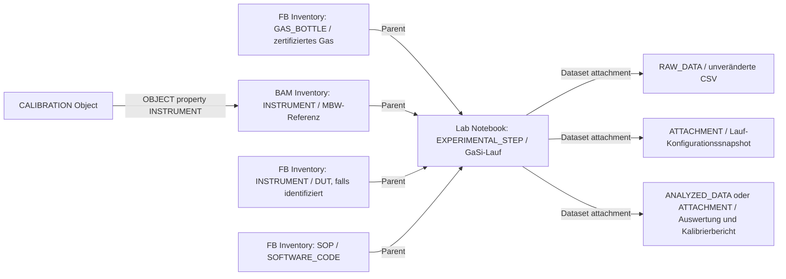

# GaSi-Datenmodell und openBIS-Zuordnung

## Status und Beleggrenzen

Dies ist ein fachlicher Vorschlag für FB 8.1, kein in openBIS registriertes Schema. Das BAM-Playground wurde in dieser Arbeit nicht angesprochen; tatsächliche Spaces, Rechte, Typen, Pflichtfelder, Vokabulare und Dataset-Typen müssen dort lesend verifiziert werden. Es wurden weder `pybis` noch Zugangsdaten verwendet.

Kennzeichnung in den Tabellen:

- **P**: in öffentlicher BAM-Dokumentation, Tutorial oder Masterdata-Quelle belegt.
- **V**: konkrete Bereitstellung, Werteliste, Pflichtstatus oder UI-Verhalten im Playground prüfen.
- **E**: mit der Data Store Steward/Data Store Team abzustimmende Masterdata-Erweiterung.

Die lokal abgelegten Quelldateien liegen unter [`data/wiki/home.txt`](../data/wiki/home.txt) und [`data/paper/tg5c00105_si_001.pdf`](../data/paper/tg5c00105_si_001.pdf). Das verlinkte Programmprojekt unter `code/gasi-2.0-python - Verknüpfung.lnk` wurde ausschließlich lesend untersucht. Die GitLab-Wiki-Seite „Messprogramm und Automatik“ verlangt eine Anmeldung; die lokale Wiki-Kopie beschreibt die GASI-Anlage, enthält aber keine ausgefüllte Durchführungs-, Rohdaten- oder Auswertungsvorschrift in den Kapiteln 6–9. Die Dokumentation behauptet deshalb keine nicht belegte Reihenfolge eines freigegebenen Prüfverfahrens.

## 1. GaSi-Ablauf aus Quellen

### Gemeinsamer Anlagenablauf

Das Wiki beschreibt die PC-gesteuerte GASI-Anlage als Mischung aus Träger-/Matrixgas, bis zu drei Komponentengasen und optionaler Befeuchtung. Sechs MFR dosieren Verdünnungs- und Befeuchtungsströme; Gaswege werden über Ventile geschaltet. Ein Gasprofil enthält Trägergas und Komponenten. Im Programm können Sollwerte, Ventilmaske, Laufzeit, Wiederholung und optionale Stabilitäts-/Messwertbedingungen je Schritt stehen.

Der Code führt einen Automatikschritt quittierungsbasiert aus: Ventilwechsel sicher vorbereiten, notwendige Flows auf null setzen, Zielventile schalten, Sollwerte setzen, nicht benötigte Ventile schließen und anschließend Dauer/Bedingung abwarten (`automation/sequence_runner.py`: `_begin_current_step`, `_phase_open_required_valves`, `_phase_apply_setpoints`, `_begin_hold`). `AUTOMATIK_STATUS` ist im CSV die angezeigte Statuszeile, nicht ein stabiler Schritt- oder Wiederholungs-Identifier. Die konkrete Sequenzdefinition liegt in `config/automation_program.json`; sie muss für jeden historischen Lauf als unveränderlicher Snapshot gesichert werden.

### Belegte Varianten und Unterschiede

| Ablauf | Gemeinsame Schritte | Unterschied / im Modell zu erfassen | Beleg und Validierungsstatus |
|---|---|---|---|
| Gasfeuchte | Trägergas/Fluss einstellen, Gasweg und Messstelle dokumentieren, Sensorantwort zeitlich erfassen | Waschflasche und Peltier-Messgaskühler konditionieren Gas; Soll-Frost-/Taupunkt und gemessener MBW-Frost-/Taupunkt sind verschieden. Das Referenzhygrometer kann laut Wiki parallel zur Messkammer oder in Reihe zum Prüfling liegen; diese Topologie steht nicht im CSV. | Wiki §1 und §4.1; Supplementary Information (SI) S. 2; im CSV sind MBW373/MBW473-Kanäle vorhanden, die konkrete Leitungsposition ist nicht validiert. |
| Gaskonzentration | Trägergas, Mischung/Verdünnung, MFR-Soll-/Istwerte, Ventilzustand, Zeitreihe | `K1..K3_KONZENTRATION` und `Kx_EINHEIT` sind Profil-/Sollkonfiguration. Ein unabhängig gemessener Referenzwert der Analytenkonzentration und die Zuordnung eines A5B-Kanals zum Prüfling sind in den vorhandenen CSVs nicht belegt. | Wiki §1 und §4.1; `gui/main_window.py`: `_build_measurement_snapshot`; Testdateien enthalten zeitweise `CO2` als Komponentengas, aber keine unabhängige Konzentrationsreferenz. |
| Kalibrierlauf | Gleiche kontrollierte Mischung, Zeitstempel, Referenzgeräte und Prüflingssignal | Zweck „Kalibrierung“, verwendeter Standard, Kalibrierfunktion, Gültigkeitsbereich, Unsicherheit und freigegebenes Ergebnis müssen explizit dokumentiert werden. Nicht aus Dateiname, Rezeptname oder `KALIBRIERUNGEN_JSON` ableiten. | Wiki §1 sagt, das Verfahren diene auch der Kalibrierung; Wiki §§6–9 sind leer. Alle 31 CSVs haben `KALIBRIERUNGEN_JSON=[]`; das ist kein Nachweis einer GaSi-Kalibrierung. |
| Referenz-/Blindwertlauf | Gleiche Messkette, aber Bezug auf zertifiziertes Gas/Referenzgerät und festgelegte Bedingungen | `purpose=reference`/`blank` und genaue Identität des Referenzmaterials sind eigene Angaben. Ein Blindwert ist nicht dasselbe wie eine Kalibrierung. | Projektlabels enthalten `Blindwert373LX`; das allein belegt weder Prüfling, Referenzmaterial noch Ablauf. |
| Temperatureinfluss | Gas-/Feuchtestufe und zeitaufgelöste Referenz-/Prüflingskanäle | Temperatur-Sollwert, tatsächliche Prüflingstemperatur und Gas-/Referenztemperatur separat mit Sensor, Messort und Zeitzugriff. `KLIKA_C` ist der Istwert der BINDER-Klimakammer; der Sollwert wird im Code separat gehalten, steht aber nicht im CSV-Kopf. | `gui/main_window.py`: `_on_climate_values`, `_build_measurement_snapshot`; Logger-Spalte `KLIKA_C`. Keine KLIKA-Sollwertspalte und kein belegter Temperatur-Sweep im vorhandenen 20-h-Rezept. |

Die Temperaturkanäle haben nicht dieselbe Bedeutung: `KLIKA_C` ist die gemessene Isttemperatur der BINDER-Klimakammer. `PT_PROZESS_C`, `MGK_INPUT_C`, `MGK_TSAT_C`, `KELLER_T1_C` und `KELLER_T2_C` sind Prozess-/Messgaskühler-/Drucksensor-Kanäle. `MBW*_EXTERNAL_TEMP_C` ist die externe Hygrometertemperatur, nicht automatisch die Prüflingstemperatur. Temperaturversuche brauchen mindestens eine explizite Sollwertquelle und eine Zuordnung zum tatsächlichen Fühler am Prüfling.

### Sollwert, Referenzwert und Prüflingssignal

| Fachliche Rolle | Vorhandene Quelle/Felder | Interpretation |
|---|---|---|
| Sollwert Gaszusammensetzung | Gasprofil; `K1..K3_GAS_ID`, `K1..K3_KONZENTRATION`, `K1..K3_EINHEIT` | Profilkonfiguration. Nicht als gemessene Konzentration bezeichnen. |
| Soll-/Istfluss | `MFC1..MFC8_SOLL`, `_IST`, `_SOLL_CO2EQ`, `_IST_CO2EQ`, `_UNIT`, Faktor-/Statusfelder | Geräte-/Betriebswerte. `gas_flow_config.json` beschreibt die FLUIDAT-Konvention `Q_device_CO2_equivalent = Q_real_operation * fluidat_factor` sowie die Umkehrung. `mln/min` ist mit 0 °C und 1013.25 mbar absolut als Referenzbedingung hinterlegt. Kanalbedeutung und Einheit je MFC im Playground gegen Gerätetyp prüfen. |
| Feuchtereferenz | `MBW373_FROST_POINT_C`, `MBW373_HEAD_PRESSURE_PA`, `MBW373_EXTERNAL_TEMP_C`, `MBW373_FLOW_L_MIN`, `MBW373_STABLE` und entsprechende `MBW473SP2_*` | Hygrometer-Messwerte und Qualitäts-/Betriebsstatus. Der Code nennt den Kanal `FROST_POINT`; eine Umrechnung in relative Feuchte oder Stoffmengenanteil ist nicht im Export enthalten. |
| Prüflingssignal | `A5B_CH01_mV` bis `A5B_CH16_mV` | Rohspannungs-Kanäle. Das CSV enthält keine verlässliche Zuordnung von Kanal zu DUT, Sensorelement oder Ausgangsgröße; Rohwerte bleiben bis zur Kanal-/Gerätezuordnung unklassifiziert. |
| Temperatur | `KLIKA_C`, `PT_PROZESS_C`, `MGK_INPUT_C`, `MGK_TSAT_C`, `KELLER_T1_C`, `KELLER_T2_C`, MFC-/Alicat-/MBW-Temperaturen | Zeitgleiche Geräte-/Prozesskanäle mit unterschiedlichen Messorten. Die Klimakammer-Solltemperatur fehlt im CSV. |
| Druck | `ELP9_*_bar`, `ALICAT_DRUCK`, `KELLER_P1_bar`, `KELLER_P2_bar`, MBW-Kopfdruck in Pa | Nicht in eine gemeinsame Druckgröße überführen, bevor Messort sowie absoluter/relativer Druck geklärt sind. `ALICAT_DRUCK` hat im Spaltennamen keine Einheit. |
| Unsicherheit | Kein Unsicherheitsfeld in den 252 CSV-Spalten; `uncertainty_percent` in der MFC-Konfiguration ist `null` | Gaszertifikat, Referenzgeräte-Kalibrierung, MFC-Faktor und Auswerteunsicherheit getrennt aus ihren Nachweisen erfassen. Keine Unsicherheit aus der Auflösung der CSV ableiten. |

### CSV- und Sessionbefunde

Alle 31 Dateien in `data/measurements/` wurden lokal eingelesen: 57.222 Datenzeilen, ein tabgetrenntes Schema mit 252 Spalten, Dezimalkomma und einer absichtlich leeren dritten Kopfspalte. Die Stichprobenintervalle häufen sich bei 5 s und 30 s; einzelne Abstände von 29/31 s sind vorhanden. Der aktuelle `config/logging_settings.json`-Wert ist 5 s und kann die historischen 30-s-Dateien nicht erklären, weil kein Konfigurationssnapshot pro CSV mitgeliefert wurde.

Die Dateien decken sieben `PROJEKT_NAME`-Labels ab: `2026-10-12_FA510_3_h` (6 Dateien), `2026-10-16_FA510_und_373` (8), `2026-10-21_373LX` (8), `2026-11-02_Blindwert373LX` (3), `2026-11-04_Blindwert373LX` (2), `2026-11-04_LDP-Test` (3) und `2026-11-06_LDP-Test2` (1). Sie verwenden im CSV dieselbe Gasprofil-ID; `CO2` erscheint als Komponente nur in einem Teil der frühen Dateien. In allen Dateien ist der Simulator aus und die Kalibrierungs-JSON-Liste leer. MBW-Verfügbarkeit variiert. Das sind reale Logger-Exporte, aber aus den verfügbaren Metadaten nicht als sieben vollständige, fachlich abgegrenzte Kalibrier-/Referenzläufe beweisbar.

Am 25.10.2026 springt der lokale CSV-Zeitstempel in derselben Datei von `02:59:41` zurück auf `02:00:11`. Das ist mit der herbstlichen Zeitumstellung vereinbar, aber der CSV-Zeitstempel enthält keine Zeitzone/UTC-Offset. Die Originalzeilenreihenfolge bleibt maßgeblich; die absolute Zeitzuordnung dieser Stunde bleibt ungeklärt. Für neue Läufe sind UTC-Zeitstempel oder zusätzlich UTC-Offset und monotone elapsed time erforderlich.

Die Logger-Implementierung formatiert Zahlen mit sechs Nachkommastellen und Dezimalkomma. Fehlende MBW-Werte werden als leer gespeichert; andere optionale Werte können über Defaultwerte als `0,000000` erscheinen. `MGK_INPUT_C` und `MGK_TSAT_C` besitzen zusätzlich den Default `-100`. Deshalb gilt: `0` nicht pauschal als gültige Messung, leer nicht als Null und `-100` nicht als physischer Wert interpretieren. Status-/Online-Spalten, Originaltext und fehlende Werte bleiben zusammen erhalten.

**Datei ist nicht gleich Messlauf.** `MeasurementLogger.start()` erzeugt einen Namen `meas_log_YYYYMMDDHHMM.csv`, bei Tageswechsel entstehen Tagesdateien. Ein CSV-Datensatz enthält weder `measurement_session_id` noch Rezept-/Konfigurationshash. Der Code hat zwar SQLite-Tabellen für `measurement_sessions`, `measurement_session_files`, `measurement_samples` und `measurement_events` mit `session_id`, `recipe_name`, Zeitstempeln und Pfadzuordnung; in den vorliegenden Testdaten ist die SQLite-Datei nicht vorhanden. Der Dateiname und `PROJEKT_NAME` allein sind daher kein stabiler Run-Key.

Weitere offene Diskrepanzen aus der Quellenprüfung:

- `config/active_project.json` nennt `2026-10-12_FA510_3_h`, `config/automation_program.json` dagegen `2026-10-12_FA510_20_Stunden`. Der Projektname ist kein Rezeptnachweis; die tatsächlich gefahrene historische Rezeptversion fehlt.
- Das Wiki §4.1 nennt ca. 1,5 bar Überdruck am Eingang der Prüfeinrichtung. Die SI des Artikels von Bayat et al. beschreibt für die konkrete Wasserstoff-Befeuchtung 1,1–1,5 bar(a) am Sättiger und 1,3 bar(a) an den MFR. Das sind unterschiedliche Messstellen/Versuchsbedingungen, keine ohne Weiteres austauschbaren Werte.
- Im Beispiel steht im Feld `MBW373_ID` neben `MBW 373LX` ein interner Geräte-ID-Text `DPM 473r2`. Nicht als Seriennummer oder anderes MBW-Modell interpretieren, bevor Format und Identität im Gerät/Playground geprüft wurden.
- Die Klimakammer- und Taupunktregler-Snapshots enthalten intern mehr Werte als `MeasurementLogger.COLUMNS` exportiert. Insbesondere Taupunktregelungs-Soll-/Fehler-/Vorsteuerungsfelder und KLIKA-Sollwert erscheinen nicht im 252-Spalten-CSV.

## 2. Fachliche Ebenen und Kennungen

| Ebene | GaSi-Bedeutung | Kennung/Beziehung | Entscheidung |
|---|---|---|---|
| Messlauf | Ein Start/Stop einer manuellen Messung oder Automatik; hat Zweck, Prüfling, Referenzgeräte, Methode und Datei(en). | `measurement_session_id`/UUID beim Start; dazu Projekt, Rezeptversion und Datei-Hash. | Ein openBIS-`EXPERIMENTAL_STEP` je fachlich eigenständigem Lauf. Für historische Dateien ohne SQLite nur ein als solcher gekennzeichneter Legacy-Datei-Schlüssel, nicht als echte Run-ID ausgeben. **E** für dedizierte `GA_SI_RUN_KEY`-Eigenschaft. |
| Messstufe | Plateau/Sequenzschritt innerhalb eines Laufs: Gas-/Feuchtesoll, Temperaturziel, Ventil-/Flowzustand, Dauer und Stabilitätskriterium. | `stage_id = recipe_version + step ordinal + repeat`; zusätzlich Start/Ende. | Kein eigenes openBIS-Objekt pro Schritt. Als Spalten/Metadaten im zugehörigen Dataset oder unveränderte Rezeptdatei führen. `AUTOMATIK_STATUS` ist nur Anzeige-Text und kein stabiler Schlüssel. |
| Messpunkt | Ein Snapshot aller gleichzeitig erfassten Kanäle. | `run_key + source file + row number`; Originalzeitstempel bleibt zusätzlich erhalten. | CSV-Zeile bleibt im Dataset. Kein Objekt pro Zeile. Für Wiederholungen und Zeitumstellung Zeilennummer und UTC/Offset/elapsed time ergänzen. |
| Prüfling (DUT) | Sensor/Sensorelement, dessen Antwort untersucht wird. | Dauerhafte Inventory-ID, vorzugsweise Instrument mit Seriennummer; mehrere Parent-Objekte, falls mehrere DUTs. | **V**: `INSTRUMENT` bei Messgerät; `SAMPLE` bei einzelnem Material/Sensorelement. Aktuelle Testdateien nennen keinen DUT-Identifier und keine A5B-Kanalzuordnung. |
| Referenzgerät / Aufbau | MBW-Hygrometer, MFC, KELLER/Alicat, BINDER, GASI-Anlage und Messkammer. | Inventory-Objekte mit persistentem Identifier, Serien-/Inventarnummer und gültiger Kalibrierung. | Als Eltern/Inputs des Messlauf-Objekts verknüpfen. Kein Freitext als Ersatz für die Geräte-ID. |
| Verfahren / Software | Freigegebene SOP und GASI-Version/Rezept. | SOP-/Software-Inventory-Objekt und immutable Datei-/Commit-Hash. | Nur die tatsächlich verwendete, freigegebene Version verknüpfen; aktuelle JSON-Datei nicht rückwirkend dem Testlauf zuordnen. |

### Stufenparameter richtig zuordnen

- **Laufebene:** Messart (Feuchte/Konzentration), Zweck (Charakterisierung/Kalibrierung/Referenz/Blindwert), DUT, verantwortliche Person, SOP-/GASI-Version, Raum/Setup, Beginn/Ende, verwendete Referenzgeräte, Referenzgas-Zertifikat, gesamter Rohdaten- und Ergebnisumfang.
- **Stufenebene:** Gasprofil/Komponenten, Sollkonzentration samt Einheit und Bezug, Feuchte-/Frostpunktsoll, Temperatur-Sollwert, Druck-/Durchflusssollwerte, Ventilprofil, Dauer und Stabilitätsbedingung. Bei wechselnden Stufen gehören die Einzelwerte in einen Stufenplan-Datensatz statt in ein einzelnes Run-Objektfeld.
- **Messpunktebene:** Zeit, MFC-Soll-/Istwerte, Gasprofilkontext, MBW-Referenzwerte samt Status, Druck/Flow, alle Temperaturkanäle, A5B-Rohsignale und Stufen-/Wiederholungskennung.
- **Ergebnis-/Kalibrierebene:** Verwendete Referenzwerte, Fit-/Kennlinienparameter, Bereich, Restabweichung, Unsicherheitsbudget, Gültigkeit und Bericht. Nicht in Rohkanälen überschreiben; als abgeleiteter Datensatz samt Auswerteversion erhalten.

Ein Gaskomponentensoll `K1_KONZENTRATION` ist nicht der Referenzmesswert des Prüfgases. Ein `MBW*_FROST_POINT_C` ist Referenzgeräte-Messung, nicht Prüflingsantwort. Ein `A5B_CHxx_mV` ist nur dann DUT-Signal, wenn die konkrete Kanalbelegung für diesen Lauf dokumentiert ist. Die drei Rollen brauchen getrennte Felder/Spalten und Einheiten.

## 3. Konkrete Zuordnung in den BAM Data Store

Der Data Store empfiehlt `Space → Project → Collection → Object → Dataset`; die Lab-Notebook-Tutorials modellieren Aktivitäten als `Experimental Step`-Objekte und hängen die erzeugten Dateien als Datasets daran. Objekte und Inventarressourcen werden mit gerichteten Parent-/Child-Beziehungen verbunden. Datasets selbst sind keine Knoten der Object-Hierarchy.

| Ebene/Entität | Data Store-Ort | Vorhandener Typ/Kandidat und Eigenschaften | Verknüpfung und Status |
|---|---|---|---|
| Space | Bestehender FB-8.1-Lab-Notebook-Space oder der dafür freigegebene User Space. | Standard-Space; keine GaSi-Sondertypen. Exakten Code und Zugriffsgruppe aus der Instanz übernehmen. **P/V** | Nicht eigenmächtig neuen Space anlegen. Rolle und Sichtbarkeit mit DSSt abstimmen. |
| Project | Lab Notebook Space → Projekt `GASI` (Vorschlag; gegebenenfalls je Forschungsauftrag ein eigenes Projekt). | Standard-Project mit unveränderlichem `CODE` und Description. **P/V** | Kein Projekt je CSV oder Messlauf. `PROJEKT_NAME` bleibt Herkunftsmetadatum, nicht automatisch der Data-Store-Projektcode. |
| Collection | Projekt `GASI` → z. B. `MEASUREMENT_RUNS_2026` oder abgestimmte Kampagnen-Collection. | Standard-Collection (Python-v3/alte API nennt sie `Experiment`). Default Object Type `EXPERIMENTAL_STEP` prüfen. **P/V** | Nach Kampagne/Jahr ordnen, nicht in tiefe Ordnerhierarchien aufteilen. |
| Messlauf / Aktivität | Lab Notebook → Collection → ein Objekt je Messlauf. | `EXPERIMENTAL_STEP` (**P**, Tutorial + BAM-Masterdata v0). `START_DATE`, `END_DATE` (`TIMESTAMP`), `$NAME`, `EXPERIMENTAL_GOALS`, `EXPERIMENTAL_DESCRIPTION`, `EXPERIMENTAL_RESULTS`, `OPERATOR` (`VARCHAR`) sind im v0-Modell definiert; Deployment/Pflichtstatus **V**. | Raw-/Ergebnis-Datasets gehören an dieses Objekt. Run-Key, Messart, Zweck, Referenzposition und Prüflings-ID fehlen im Standardtyp: Erweiterung **E** oder zunächst ausdrücklich belegte bestehende Properties/Beziehungen verwenden. |
| Prüfling (DUT) | FB Inventory, voraussichtlich `8.1 Equipment` oder `8.1 Materials` nach Entscheidung des DSSt. | `INSTRUMENT` (**P**) bei serialisiertem Sensorgerät; `TESTING_EQUIPMENT` (**P/V**) wenn Klassifikation über Messgröße passt; `SAMPLE` (**P**) bei Sensorelement/Material. `INSTRUMENT` v0: `$NAME`, `MANUFACTURER`, `SERIAL_NUMBER`, `BAM_OE`, `BAM_LOCATION_COMPLETE`, `INSTRUMENT_STATUS`, `LAST_CALIBRATION`; Pflichtwerte/Vokabular **V**. | Parent des `EXPERIMENTAL_STEP`. Exakte A5B-Kanal-zu-DUT-Zuordnung ist derzeit offen; nicht aus `FA510` im Projektnamen ableiten. |
| GASI-Aufbau / Referenzgeräte | Geteilte Großgeräte in BAM Inventory → `BAM Equipment` → 8.1 Equipment Open → Instruments; lokale Geräte im passenden FB Inventory-Projekt. | `INSTRUMENT` (**P/V**); alternativ `TESTING_EQUIPMENT` (**P/V**) für Thermometer/Klimakammer/Hygrometer. Seriennummer, Hersteller, Modell, BAM-Inventarnummer, Status und vorhandenes `LAST_CALIBRATION` nutzen. | Alle tatsächlich eingesetzten Geräte als Eltern des Messlauf-Objekts; `MBW373_ID` allein muss auf existierendes Inventory-Objekt aufgelöst werden. Gerätebeziehungen nicht nur als `NOTES`-Text speichern. |
| Referenzgas / Flasche | FB Inventory → `8.1 Materials` → vom DSSt bestätigte Gase/Referenzmaterial-Collection. | `GAS_BOTTLE` (**P/V**) ist im öffentlichen v0-Masterdata definiert; Felder u. a. `SUPPLIER`, `GAS_VOLUME`, `GAS_PRESSURE_BAR`, `VOLUME_PERCENT_*`, `BAM_OE`. Gasarten/Kompositionsfelder sowie zertifizierte Sollwerte und Unsicherheit in Playground prüfen. | GasBottle als Parent des Messlaufs. Chargen-/Zertifikatsnummer, zertifizierter Wert, Einheit, Bezugsbedingungen, Gültigkeit und Unsicherheit am Objekt oder als verknüpftes Zertifikats-Dataset sichern. Fehlende Zertifikatsfelder ggf. **E**. |
| Formale Geräte-Kalibrierung | Inventory-Objekt mit direktem Gerätebezug; konkrete Space/Collection durch DSSt bestätigen. | `CALIBRATION` (**P/V**) v0: `INSTRUMENT` (`OBJECT`, `(ALL)`, verpflichtend), `CALIBRATION_DATE` (`DATE`), `CALIBRATION_PROVIDER` (CV), `CALIBRATION_CERTIFICATE_NUMBER` (`VARCHAR`), `ACCREDITATED_CALIBRATION_LAB` (`BOOLEAN`), optional `CALIBRATION_LAB_ACCREDITATION_NUMBER`, `NOTES`. | Property-Richtung: `CALIBRATION.INSTRUMENT → INSTRUMENT`. Das beschreibt eine formale Geräte-Kalibrierung/Zertifikat; ein interner GaSi-Kalibrierlauf bleibt zusätzlich ein `EXPERIMENTAL_STEP` mit Datasets. Aktuelle Vokabularwerte und Typbereitstellung **V**. |
| Verfahren / Software | FB Inventory → `8.1 Methods` bzw. bestätigter BAM-/FB-Softwarebestand. | `SOP` und `SOFTWARE_CODE` sind v0-Kandidaten (**P/V**); SOP-Felder schließen u. a. `ID_EAKTE`, `LINK_EAKTE`, `VERSION` ein. `SOFTWARE_CODE` hat `SOFTWARE_NAME`, `VERSION`, `SOURCE_LINK`. | Verwendete SOP/Software als Eltern des Messlaufs. Handbuch oder aktuelles Arbeitsverzeichnis nicht als freigegebene SOP behandeln. |
| Rohdatei | Dataset am jeweiligen `EXPERIMENTAL_STEP`. | `RAW_DATA` (**P/V** in BAM-Lab-Notebook-Tutorials); Original-CSV unverändert, als Tab-Delimited mit ursprünglichem Dezimalkomma. | Dataset-Überordnung durch das Run-Objekt. Dateiname, SHA-256, Header-Fingerprint, Parser-/Mapping-Version lokal prüfen und als Dataset-Metadaten oder Manifest sichern. |
| Konfiguration / Zertifikat / Kalibrierbericht | Dataset am selben `EXPERIMENTAL_STEP`. | `ATTACHMENT` (**P/V**, öffentlich im Lab-Notebook-Tutorial); bei Tabellen-/Preview-Darstellung ggf. `ELN_PREVIEW` (**P/V**). `ANALYZED_DATA` ist pyBIS-Beispieltyp, reale Data-Store-Verfügbarkeit **V**. | Unveränderte Laufkonfiguration, Gaszertifikat, Auswerteskript/-version und Kalibrierbericht als Dataset-Dateien. Keine veralteten `add_attachment()`-Objektanhänge verwenden. |

### Gerichtete Beziehungen und Beispielpfad

BAMs Beispielkonvention lautet: Ressourcen/Eingaben sind Parents der Experimental Steps, erzeugte Samples oder direkt folgende Schritte sind Children. Das Dataset hängt an dem Experimental Step, der es erzeugt hat; es wird nicht als Child-Object modelliert.



Konkreter Vorschlag für den ausgewählten lokalen Beispielexport (kein bereits registrierter Pfad):

```text
/<bestehender FB-8.1-Lab-Notebook-Space>/GASI/MEASUREMENT_RUNS_2026/<EXPERIMENTAL_STEP>
    Parent Objects: MBW-Referenzgerät; zertifiziertes Gas, falls Konzentrationslauf; DUT nur nach Identifizierung
    Dataset RAW_DATA: data/measurements/meas_log_202610131340.csv
    Dataset ATTACHMENT: nur der nachweislich zugehörige Rezept-/Konfigurationssnapshot
    Dataset ANALYZED_DATA/ATTACHMENT: nur vorhandenes Auswerteergebnis bzw. freigegebener Bericht
```

Die lokale Vorschau verwendet als Legacy-Dateischlüssel den Dateinamen; sie markiert ihn ausdrücklich **nicht** als echte Messlauf-ID. Space-Code, Inventory-Identifier und A5B-DUT-Zuordnung sind nicht im CSV und daher Platzhalter bis zur Playground-Prüfung.

### Suchbare Eigenschaften und Dataset-Inhalt

Suchbar am Experimental Step sollen Zweck/Messgröße, Lauf-ID, Start/Ende, Prüfling, Referenzgerät(e), Rezept-/SOP-/Softwareversion, Gasreferenz, grobe Konzentrations-/Feuchte-/Temperaturbereiche und Ergebnis-/Kalibrierstatus sein. Sie beantworten, welche Messung vorliegt und welche Ressource/Referenz verwendet wurde.

Die 252 zeitabhängigen Kanalspalten bleiben im RAW_DATA-Dataset. Dazu zählen MFC-Flüsse und CO₂-Äquivalent, Komponentensollwerte, MBW-Frostpunkt/Status/Druck/Flow/Temperatur, Keller-/Alicat-Druck und Temperatur, A5B-Kanäle, Ventilzustände und Pluginwerte. Stufenparameter gehören in einen mit dem Run versionierten Messplan/Datensatz, wenn sie sich innerhalb eines Laufs ändern. Keine Property pro Messpunkt und kein einzelnes Run-Property für mehrere wechselnde Stufensollwerte.

## 4. Felder, Pflichtstatus und fehlende Werte

„Pflicht“ meint hier die fachliche Mindestanforderung für die jeweilige Messart, nicht eine bereits im BAM-Server konfigurierte openBIS-Pflichtmarkierung. Exakte Typ-/Property-Assignments, Vokabularwerte und technische Pflichtstatus sind im Playground zu verifizieren.

| Feld / Entität | Typ, Einheit | Quelle | Pflicht nach Messart | Fehlend/Interpretation | Status |
|---|---|---|---|---|---|
| `$NAME`, `START_DATE`, `END_DATE` am Experimental Step | `VARCHAR`, `TIMESTAMP` | CSV-Dateiname/-Zeitstempel; künftig Session-Zeit | alle Läufe | Zeit ohne TZ/Offset; leer/mehrdeutig markieren, niemals still UTC annehmen | `$NAME`/Dates **P/V** |
| `GA_SI_RUN_KEY` | `VARCHAR`/stabiler Schlüssel | SQLite `session_id` oder vor Start erzeugte UUID; CSV derzeit ohne Schlüssel | alle Läufe | Legacy nur file-level surrogate; keine eindeutige historische Session | **E** |
| `GA_SI_MEASUREMENT_QUANTITY` | kontrolliertes Vokabular: Gasstoffmengenanteil, Frost-/Taupunkt o. ä. | Prüfplan | alle Läufe | Nicht aus Einheit oder Profil raten | **E** |
| `GA_SI_PURPOSE` | kontrolliertes Vokabular: Charakterisierung, Kalibrierung, Referenz, Blindwert | Prüfplan/Auftrag | alle Läufe | Unbekannt als unbekannt speichern, nicht aus `PROJEKT_NAME` schließen | **E** |
| Prüflings-Identifier und A5B-Kanalzuordnung | `OBJECT`-Beziehung; Kanal in Dataset, mV | Inventar + geprüfte Anschluss-/Kanalbelegung | DUT-Messung/Kalibrierung/Referenz | Aktuell keine DUT-ID; A5B mV bleiben unzugeordnet | Beziehung **P/V**, Mapping ggf. **E** |
| Referenzgerät-Identifier | `INSTRUMENT`-Objektbeziehung | MBW-/Geräteseriennummer und Inventory | Feuchte-Referenz/Kalibrierung verpflichtend | `MBW*_ID` ist Text, erst per Seriennummer auf Inventory auflösen | **P/V** |
| Referenzgas-/Flaschen-Identifier | `GAS_BOTTLE`/`CHEMICAL` Objektbeziehung | Gaszertifikat, Flaschen-/Chargen-ID | Konzentrations-Referenz/Kalibrierung verpflichtend | `GASPROFIL_ID` ist kein Zertifikat und keine Flaschen-ID | Typ **P/V**, Zertifikatsfelder ggf. **E** |
| Gasprofil und Sollkomponenten | String/`REAL` + explizite Einheit je Komponente | `GASPROFIL_ID`, `Kx_GAS_ID`, `Kx_KONZENTRATION`, `Kx_EINHEIT`; Rezept | Konzentrationsläufe; für Blind-/Feuchteversuch nach Protokoll | Diese Werte sind Soll-/Profilkontext; leere Komponente bleibt leer, kein Nullgas daraus ableiten | CSV/Dataset **P**; Run-Suchproperty **V/E** |
| Feuchtereferenz | `REAL`: °C Frostpunkt; Pa; L/min; `BOOLEAN` stabil | `MBW373_*` / `MBW473SP2_*` pro Messpunkt | Feuchte-Kalibrier-/Referenzlauf | Leere Werte + Online/Stabilität erhalten; online=0 nicht als 0 °C lesen | Dataset **P** |
| DUT-Signal | `REAL`, mV | `A5B_CH01_mV`…`CH16` | DUT-Lauf | Kein Kanal/DUT-Bezug: als Rohkanal, nicht als Konzentration ausgeben | Dataset **P**, Zuordnung **E/V** |
| Temperaturziel / Prüflingstemperatur | `REAL`, °C, Sensor-/Messort-ID | Rezept/Prüfplan und Fühler | Temperatureinflusslauf | `KLIKA_C` ist Ist, nicht Soll; Ziel fehlt im CSV. Fühler am DUT nicht belegt | Istkanal **P**, Soll-/Zuordnung **E** |
| MFC-Soll/Ist und Umrechnungsfaktor | `REAL` + `MFC*_UNIT`; Bezugsbedingungen separat | CSV + Snapshot der FLUIDAT-/MFC-Konfiguration | Konzentrations-/Feuchtestufen, sofern MFC verwendet | Rohstring/Dezimalkomma bewahren; Faktorstatus und -quelle mitführen. `preliminary_unvalidated` nicht als validiert ausgeben | CSV **P**, Vollständigkeit **V** |
| Druckwerte | `REAL` mit Messort und `bar(a)`/`bar(g)` bzw. Pa | MBW, ELP, KELLER, Alicat | soweit Druck in Verdünnung/Feuchteberechnung eingeht | Aktueller CSV-Spaltenname klärt Referenz nicht durchgehend; keine Umrechnung bis Messort/Nullpunkt geklärt | Dataset **P**, semantische Zuordnung **V/E** |
| Messunsicherheit | `REAL` mit Einheit/Abdeckungsfaktor oder referenzierter Unsicherheitsdatei | Referenzgeräte-/Gaszertifikat, Methode, Auswertung | Kalibrierung und Referenzbewertung verpflichtend | Derzeit nicht in CSV; MFC-Konfigurationswert `uncertainty_percent=null` | **E/V** |
| Rezept/Software/SOP-Version | Objektbeziehung oder `VARCHAR` + Datei-/Commit-Hash | historische Projekt-/Rezeptdatei, Release/Hash, freigegebene SOP | Automatik; für freigegebene Kalibrier-/Referenzverfahren | Aktuelle externe JSON-Datei ist kein historischer Snapshot | Typ/Beziehung **P/V**, Snapshot **E** |
| `CALIBRATION`-Datensatz | BAM v0 Properties unten; Messpunkte bleiben Dataset | Kalibrierstelle/Zertifikat | formale Geräte-Kalibrierung | Kein Zertifikat/Eintrag in den lokalen Testdateien; `CALIBRIERUNGEN_JSON=[]` bezieht sich auf GASI-Korrekturmodelle | Typ **P/V**; GaSi-Ergebnisfelder ggf. **E** |

Fehlende Werte werden als fehlend behandelt, nie automatisch mit 0 gefüllt. Für historische CSVs bleibt ein ausgegebenes `0,000000` als Rohwert erhalten, aber fachlich `ambiguous_zero`, wenn kein Status die Gültigkeit belegt. Ein lokales Importmanifest darf Rohstring und normalisierten Zahlenwert nebeneinander speichern; Zeit und Originalzeile sind unverändert zu bewahren.

## 5. Playground-Prüfung und Masterdata-Abstimmung

Vor einer `pybis`-Umsetzung im BAM-Playground prüfen:

1. Den bestehenden FB-8.1-Lab-Notebook-Space, den freigegebenen Project-Code, Zugriffsrechte und die tatsächlichen Collection-Pfade ermitteln; vorgeschlagene Codes nicht ungeprüft anlegen.
2. Verfügbarkeit und Assignment/Pflichtstatus von `EXPERIMENTAL_STEP`, `INSTRUMENT`, `TESTING_EQUIPMENT`, `GAS_BOTTLE`, `CALIBRATION`, `SOP` und `SOFTWARE_CODE` ansehen. Bei `TESTING_EQUIPMENT` die vorhandene Measurement-Quantity-Vokabelliste für Frost-/Taupunkt, Temperatur und Durchfluss prüfen.
3. Die DataSet-Typen `RAW_DATA`, `ATTACHMENT`, `ELN_PREVIEW` und ggf. `ANALYZED_DATA` in der konkreten Instanz prüfen; bestätigen, dass CSV, Konfigurationssnapshot, Zertifikat und Bericht je am Experimental Step angelegt werden können.
4. MBW373/473 Identität, die `DPM 473r2`-Anzeige, MFC-/Keller-/Alicat-Seriennummern, BAM-Inventarnummern, `bar(a)`/`bar(g)` und MFC-Normalbedingungen mit Geräten/Unterlagen abgleichen.
5. Prüfling und A5B-Kanalzuordnung sowie MBW-Messstellenposition (parallel/in Reihe) für jeden Aufbau festlegen. Diese Verknüpfungen sind nicht aus den vorhandenen CSVs rekonstruierbar.
6. Temperaturplan festlegen: geregelter Sollwert, tatsächliche DUT-Temperatur, Sensor/Messort und synchronisierte Messzeit; bestimmen, wie BINDER-Sollwert/Bestätigung und Temperaturprogramm versioniert werden.
7. Für Konzentrations-Referenzläufe ein zertifiziertes Gasobjekt mit Zusammensetzung, Einheit, Bezugsbedingungen, Zertifikatsnummer, Gültigkeit und Unsicherheit bestimmen. Vokabular- und Zertifikatsfelder prüfen.
8. Eine Datei testweise als Dataset an einem Experimental Step registrieren, Parent-Richtung von Inventory-Objekten kontrollieren und Hierarchy Graph/Hierarchy Table prüfen. Keine echten Produktivdaten in einem Playground-Test erzeugen.

Für Erweiterungen empfiehlt BAM Masterdata zuerst ein GitHub-Issue mit benötigten Entity Types/Properties/Vokabularen, fachlichem Bedarf, Parser-/Bestandsdatenwirkung und Umsetzungsvorschlag (Python-Modul oder Excel). Danach Version/Modul mit DSSt und Data Store Team abstimmen; nicht annehmen, dass der im Schema Explorer gezeigte v1-Katalog bereits im Playground deployt ist. Die dokumentierte v1-Arbeit ist im Aufbau und führt `CALIBRATION`/`MEASUREMENT` als Aktivitäten, unterscheidet sich aber in der noch offenen Übernahme des v0-`INSTRUMENT`-Verweises.

Konkreter Erweiterungsbedarf, falls Playground keine passenden Bestandsfelder bereitstellt:

- `GA_SI_RUN_KEY`, `GA_SI_MEASUREMENT_QUANTITY`, `GA_SI_PURPOSE` und kontrollierte Wertelisten für Feuchte/Konzentration sowie Kalibrierung/Referenz/Blindwert.
- `GA_SI_DUT_CHANNEL_MAP`, `GA_SI_REFERENCE_POSITION`, `GA_SI_GAS_STANDARD_CERTIFICATE` und `GA_SI_TEMPERATURE_SETPOINT_C`/Messort, sofern nicht als versioniertes Dataset/Beziehung lösbar.
- `GA_SI_STAGE_ID`, Wiederholungsindex, Sollwert/Referenzwert/DUT-Kanal im Datenexport, wenn die spätere Auswertung ohne aufwändige Rekonstruktion durchsuchbar sein muss.
- Für Messunsicherheit: Wert, Einheit, Abdeckungsfaktor/Vertrauensniveau und Quelle; keine generische Freitextzahl ohne Definition.

## Quellen und konkrete Belegstellen

- GaSi-Wiki lokale Kopie: [home.txt](../data/wiki/home.txt), §§1 „Verfahrensprinzip“, 4.1 „Gasmischsystem“, 5 „Verwendete Prüfmittel“, 6–9 (Überschriften ohne Inhalte), 13 „Wissenschaftliche Arbeiten“. Live-Seite „Messprogramm und Automatik“ ist BAM-GitLab-login-geschützt.
- GaSi-Betriebshandbuch im nur-lesend geöffneten Projekt (`docs/GASI_Handbuch.html`): §§8 „Messung & Logging“, 9 „Automatik & Rezepte“, 10 „Projekte“, 11 „Datenbank, Berichte & Kalibrierung“, 13 „BINDER & DPM“, 16 „Dateien & Pfade“.
- Bayat, Kipphardt, Tiebe, Tuma & Engelhard (2025), *Trace-Level Ammonia–Water Interactions in Hydrogen*, ACS Measurement Science Au 5(6), 897–911, DOI [10.1021/acsmeasuresciau.5c00105](https://doi.org/10.1021/acsmeasuresciau.5c00105). Lokale Supplementary Information: [tg5c00105_si_001.pdf](../data/paper/tg5c00105_si_001.pdf), S. 2, „Humidification unit“. Der ACS-Haupttext lieferte hier HTTP 403; nur bibliographische Metadaten und lokale SI wurden geprüft.
- Das Wiki §13 führt Pichlmaier (1991), *Befeuchtung von Prüfgas für die Kalibrierung von Gas- und Feuchtesensoren*, tm 58 (1991), 471–477, DOI [10.1524/teme.1991.58.jg.471](https://doi.org/10.1524/teme.1991.58.jg.471), und Pichlmaier (1990), *Kalibriertechnik für Gassensoren*, tm 57 (1990), 419–423, DOI [10.1524/teme.1990.57.jg.419](https://doi.org/10.1524/teme.1990.57.jg.419). Die Artikeltexte waren online nicht extrahierbar und liegen nicht lokal vor; sie werden nicht als Beleg für hier nicht gelesene Formeln/Unsicherheiten verwendet.
- BAM Data Store: [Research data structure](https://bamresearch.github.io/openBIS-data-store-tutorials/represent-data-research-data/) (workflow → Data Store); [Lab Notebook](https://bamresearch.github.io/openBIS-data-store-tutorials/lab-notebook/) (Experimental Step + Raw Data/Attachment/ELN Preview); [Inventory](https://bamresearch.github.io/openBIS-data-store-tutorials/inventory-users/) (BAM/FB Inventory); [Object relationships](https://bamresearch.github.io/openBIS-data-store-tutorials/connect-data/) (Richtung, Datasets am Experimental Step); [Group ELN settings](https://bamresearch.github.io/openBIS-data-store-tutorials/custom-eln/); [Steward self-learning](https://bamresearch.github.io/openBIS-data-store-tutorials/self-learning-path/).
- BAM Masterdata: öffentliches v0-Schema `bam_masterdata/datamodel/v0/object_types.py` in [bam-masterdata](https://github.com/BAMresearch/bam-masterdata/blob/main/bam_masterdata/datamodel/v0/object_types.py); v1-Aktivitäten in [activities.py](https://github.com/BAMresearch/bam-masterdata/blob/main/bam_masterdata/datamodel/v1/activities.py); Typ-/Property-Verfahren in [Define object types](https://bamresearch.github.io/bam-masterdata/howtos/object_types/); Referenzen in [Work with Object References](https://bamresearch.github.io/bam-masterdata/howtos/object_references/); Erweiterungsweg in [Extend Masterdata](https://bamresearch.github.io/bam-masterdata/howtos/extend_masterdata/).
- openBIS/pyBIS 20.10.12: [Python V3 API](https://openbis.readthedocs.io/en/20.10.12-plus/software-developer-documentation/apis/python-v3-api.html), insbesondere Glossary, Masterdata, Collections/Experiments, Objects/Samples und Datasets.
- Codebelege aus dem verlinkten Read-only-Projekt: `logger/measurement_logger.py` (`COLUMNS`, `_sample_row`, `_format_value`, `_prepare_candidate`); `gui/main_window.py` (`start_measurement`, `_build_measurement_snapshot`, `_automation_condition_values`, `_on_climate_values`); `automation/sequence_runner.py` (`_begin_current_step`, `_target_setpoints`, `_begin_hold`); `database/measurement_database.py` (`start_session`, `register_session_csv_path`, `write_sample`); Konfiguration `config/active_project.json`, `config/automation_program.json`, `config/gas_flow_config.json`, `config/calibrations.json`, `config/logging_settings.json`.
