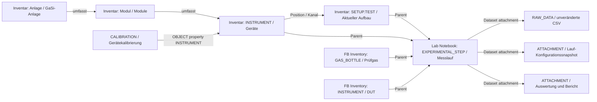
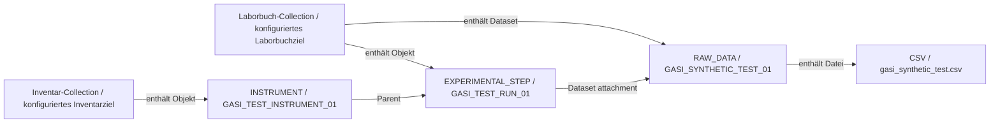

# GaSi-Datenmodell: aktueller Aufbau und Messlauf

## Ziel und Beleggrenzen

Das Modell beschreibt **das aktuelle GaSi-Setup** der BAM, FB 8.1. Es ist kein in openBIS registriertes Schema. Frühere Gerätebestände und Umbauhistorien sind nicht Teil dieses Schritts. Ein Messlauf hält fest, welcher Aufbaustand bei seiner Aufnahme verwendet wurde.

Die Grundlage sind Wiki, Betriebscode, Loggerdateien und lokale Geräteunterlagen. Originalunterlagen, Seriennummern und gerätespezifische Befunde bleiben unter `data/datasheets/` beziehungsweise in der ignorierten `config/gasi_setup.json`. Die öffentliche Modellgrafik enthält diese Informationen nicht.

Die unten genannten Standardtypen wurden am 12.11.2026 lesend im Playground geprüft;
die fachliche Zuordnung und die konkreten Testziele benötigen weiterhin die Bestätigung
des Data Store Stewards. Ein sichtbarer Typ bestätigt weder Schreibrechte noch eine
fachliche Freigabe. Die allgemeinen Anlagen-/Modulbeziehungen bleiben ein Vorschlag.

## 1. Anlage, Module und Geräte

| Ebene | Bedeutung für GaSi | Was festgehalten wird |
|---|---|---|
| Anlage | Die gesamte Einrichtung | Name, Standort, Verantwortlichkeit und Übersicht |
| Modul | Zusammengehörige Baugruppe | Gasmischung, Befeuchter und Messkette |
| Gerät | Eine konkrete, einzeln identifizierbare Einheit | Hersteller, Modell, Serien-/Inventarkennung, Bereich, Unterlagen und Prüfmittelstatus |
| Aktuelles Setup | Die heutige Zuordnung dieser Geräte | Position, Aufgabe, Gasweg, Messort, Kanal und Verbindungseinstellungen |

Das Gasmischmodul umfasst die Positionen MFC 1–6. Der Befeuchter ergänzt zwei LDP-Regler und die Druckregelung. Die Messkette enthält die tatsächlich eingesetzten Referenzgeräte, Fühler, Prüflinge und die Erfassung. Zusatzmodule werden bei bestätigtem aktuellem Einsatz ergänzt.

**Eine Position ist kein Gerät.** „MFC 1“, „LDP 7“, Busadresse und A5B-Kanal sind Zuordnungen. Seriennummer oder bestätigter Inventareintrag identifizieren das Gerät. Ein USB-Adapter identifiziert nicht automatisch das angeschlossene Messgerät. Ein MFM misst Durchfluss; ein MFC kann zusätzlich regeln.

Einzeln identifizierbare, austauschbare, wartbare oder kalibrierbare Komponenten erhalten Geräteeinträge. Für passive Bauteile genügt zunächst ein Anlagenplan beziehungsweise eine Stückliste. Vorhandene BAM-Inventareinträge werden wiederverwendet.

## 2. Genau ein aktueller Aufbaustand

`config/gasi_setup.json` beschreibt einen aktuellen Stand. Die Vorlage `config/gasi_setup.example.json` enthält nur Positionen, keine echten Gerätekennungen. Notebook 02 prüft diesen Stand lokal und erzeugt einen ignorierten HTML-Bericht mit konkreten offenen Angaben.

| Geräteangabe | Regel |
|---|---|
| Identität und Einbau | Hersteller, Modell und Kennung belegen; `installed_confirmed` erst nach Bestätigung der aktuellen Position setzen. |
| Bereich und Einheit | Dokumentierten Bereich vom aktiven Gerätebereich unterscheiden. Widersprüche bleiben offen. |
| Gasrollen | Auslegungsgas/Fluidset, tatsächlich verwendetes Kalibriermedium und Betriebsgas trennen. `DEVICE_LIBRARY` ist keine Gasidentität. |
| Bezugsbedingungen | Bei Normalvolumenstrom Referenztemperatur und absoluten Referenzdruck führen. Leitungsdruck und Gastemperatur sind andere Größen. |
| Prüfmittelstatus | Individuelle Nachweise mit ihren Bedingungen bewerten. Datenblatt und Kalibrieraufkleber ersetzen keinen Kalibrierschein. |
| Kanal und Messort | Kanal → Geräteposition → tatsächlicher Messort; Unbekanntes nicht als Prüflingssignal oder Gastemperatur ausgeben. |

Es wird kein Änderungsjournal und keine Rekonstruktion früherer Umbauten aufgebaut. Für neue Messläufe wird die tatsächlich verwendete Setup-Datei als Snapshot mit SHA-256 gespeichert. So bleibt der Lauf nachvollziehbar, wenn die aktuelle Konfiguration später geändert wird.

## 3. Messlauf, Messstufe und Datei

| Ebene | GaSi-Bedeutung | Ablage |
|---|---|---|
| Messlauf | Fachlich zusammengehörige Aufnahme mit Zweck, Prüfling, Aufbau, Referenzen, Verfahren/Softwarestand und Messplan. | Ein `EXPERIMENTAL_STEP` im Laborbuch; eindeutige Laufkennung, Beginn/Ende mit Zeitzone, verantwortliche Person. |
| Messstufe | Schritt oder Plateau innerhalb eines Laufs. | Messplan/Datensatz mit Stufenkennung, Sollwerten, Dauer und Wiederholung. |
| Messpunkt | Zeitlich zugeordneter Snapshot der Kanäle. | CSV-Zeile im Dataset; kein Objekt pro Zeile. |
| Datei | Loggerexport, Konfiguration oder Ergebnis. | Dataset am Lauf; Inhalt und Hash bleiben erhalten. |

**Datei ist nicht gleich Messlauf.** Ein Lauf kann mehrere Dateien erzeugen; ein Export kann mehr als eine Aufnahme enthalten. Die lokale Vorschau erfindet weder Laufkennung noch Start-/Stopzeiten oder Setup-Zuordnung. Ein aktuelles Setup beweist nicht, mit welchem Aufbau eine vorhandene Datei erzeugt wurde. Es erscheint in der Vorschau ausschließlich als noch nicht zugewiesener Kontext. Alte Dateien müssen für diesen Schritt nicht rekonstruiert werden.

## 4. Messwerte fachlich richtig einordnen

| Angabe | Bedeutung |
|---|---|
| Gasprofil / Stufensoll | Gewünschte Zusammensetzung oder Feuchte; keine unabhängig gemessene Konzentrationsreferenz. |
| MFC Soll/Ist | Geräte-/Betriebswerte mit Gasumrechnung, Einheit und Bezugsbedingungen. |
| MBW-Werte | Referenzkandidaten; Identität, Status, Messmodus und Messort müssen zum Lauf passen. |
| Prüflingssignal | Nur bei bestätigter Zuordnung von Kanal und Prüfling. |
| Temperaturen | Kammer-Ist, Geräte-/Prozesstemperatur, Messorte und berechnete Größen trennen. |
| Unsicherheit | Spezifikation, Kalibrierung, Umrechnung und Ergebnisunsicherheit unterscheiden; Prozent vom Messwert ist etwas anderes als Prozent vom Endwert. |

Der aktuelle Betriebscode interpretiert A5B_CH11 als MGK-Eingang zur Temperaturumrechnung. Andere A5B-Kanäle sind ohne Zuordnung zunächst Rohspannungen. Eine berechnete Sättigungstemperatur ist keine zusätzliche direkt gemessene Temperatur. `KLIKA_C` bezeichnet Kammer-Ist und nicht automatisch Prüflingstemperatur.

`RAW_DATA` bedeutet unveränderter Loggerexport; der Export kann bereits softwarekorrigierte Werte enthalten. Korrekturmodell und Auswerteversion sind mitzuführen. Leere Felder, Null, Statusinformationen und Sentinelwerte nicht gleichsetzen. Neue Zeitstempel benötigen UTC oder UTC-Offset; eine lokale Uhr-Rückstellung wird nicht automatisch aufgelöst.

## 5. Grafische Ordnung

Die Grafik erklärt die fachliche Ordnung. „umfasst“ und „Position / Kanal“ legen noch keine openBIS-Property fest. Für den aktuellen Aufbau ist `SETUP.TEST` ein zu prüfender Kandidat; die Setup-Datei bleibt unabhängig davon am Messlauf erhalten.

### Konkrete openBIS-Beziehungen des Schreibtests

Diese zweite Grafik zeigt ausschließlich den in Notebook 05 implementierten Test.
**Sie ist ein Erstellungsplan, kein Nachweis bereits vorhandener Einträge.** Die
beiden Collections müssen bestehen; Notebook 05 legt sie nicht an. Die einmalige
Anlage übernimmt `GaSi_Playground_Testbereich_anlegen.ipynb`. Ihre exakten Pfade
stehen zentral in der lokalen `config/playground_test_target.json` und erscheinen
vor dem Schreiben in Notebook 05. Die öffentliche Grafik enthält keine lokalen Zielpfade.

| Verbindung | Konkret in pyBIS | Bedeutung |
|---|---|---|
| Collection → Instrument bzw. Messlauf | `new_sample(experiment=collection_path, ...)` | Ablagezuordnung; keine Parent-Beziehung zwischen Collection und Objekt. |
| Instrument → Messlauf | `parents=[instrument.identifier]`; Reparatur über `add_parents(...)` und `save()` | Instrument ist **Parent**, Messlauf ist **Child**. Rückprüfung über `run.get_parents()`. |
| Messlauf → Dataset | `new_dataset(sample=run.identifier, experiment=lab_collection_path, ...)` | Dataset gehört zum Messlauf und zur Laborbuch-Collection; es ist kein Child-Objekt. Rückprüfung über `run.get_datasets()`. |
| Dataset → CSV | `files=[synthetic_csv_path]` | Die Datei liegt im Dataset; Rückdownload und SHA-256 prüfen ihren Inhalt. |

Anlage, Module, Setup, Prüfgas, Prüfling, Kalibrierobjekte und zusätzliche Anhänge
werden durch diesen Test **nicht angelegt**. Der allgemeine Modellvorschlag oben
beschreibt spätere fachliche Zuordnungen. Testinstrument und Testlauf werden über
ihre stabilen Codes wiedergefunden, das Dataset über seine Zugehörigkeit und den
stabilen Namen. Dataset-Code/PermID vergibt der Server; sie erscheinen nach dem Test.

Der ausgeführte Live-Test mit IDs, Browserlinks, Wiederaufnahme und Hashvergleich
ist im [Playground-Testnachweis](GaSi_Playground_Testnachweis.md) dokumentiert.

## 6. Zuordnung im BAM Data Store

| Inhalt | Kandidat / Ort | In der Instanz zu prüfen |
|---|---|---|
| Anlage, Module und Geräte | Passender Inventartyp; `INSTRUMENT` oder `TESTING_EQUIPMENT` für Geräte | Zielbereich, Pflichtfelder, vorhandene Einträge und Zugehörigkeitsbeziehung |
| Aktueller Aufbau | `SETUP.TEST`, falls geeignet; sonst vereinbarte Zuordnung plus Setup-Datei | Typ, Objektverweise und Positionen |
| Messlauf | `EXPERIMENTAL_STEP` in einer Laborbuch-Collection | Zielpfad, Namen-/Zeitfelder, Zweck, Verantwortlichkeit und Ressourcen |
| Gas / Referenzmaterial | `GAS_BOTTLE` oder geeigneter Materialtyp | Flasche/Charge, zertifizierter Wert, Bedingungen und Nachweis |
| Gerätekalibrierung | `CALIBRATION` mit Gerätebezug | Pflichtfelder, Zertifikatsnummer und Geltungsbereich |
| Dateien | `RAW_DATA` und `ATTACHMENT` am Lauf | Dataset-Typen und Rechte |

Ressourcen sind gemäß BAM-Laborbuchkonvention Parents des Messlaufs; Dateien sind Datasets am Lauf und keine Child-Objekte. Fachliche Zugehörigkeit im Inventar wird davon unterschieden. Nur tatsächlich beteiligte Geräte werden dem Lauf zugeordnet.

Ein Dataset kann mehrere zugehörige Dateien enthalten. `RAW_DATA`, `ATTACHMENT` und das optional zu prüfende `ELN_PREVIEW` sind Dataset-Typen; CSV, PNG und ZIP sind Dateiformate. Anzeigenamen (`$name`) werden von stabilen Codes und Identifiern unterschieden.

Geräteunterlagen gehören zum Gerät, Kalibrierscheine zum Gerät beziehungsweise Kalibrierobjekt. Beim Lauf werden die verwendeten Nachweise referenziert. Zielpfade folgen `Space → Project → Collection → Object → Dataset`; exakte Codes werden aus der Instanz übernommen.

### Lesender Instanzabgleich vom 12.11.2026

Fundstelle: Property-Assignments, Typkataloge und sichtbare Collections der
BAM-Playground-API, abgefragt durch `discover_playground`; der vollständige Befund
bleibt lokal unter `.local_playground_test/playground_discovery.json`.

| Typ | Lesend bestätigter Stand | Folgerung |
|---|---|---|
| `INSTRUMENT` | Pflicht: `$NAME`, `MANUFACTURER`, `BAM_OE`, `BAM_LOCATION_COMPLETE`; `SERIAL_NUMBER` ist optional. | Stabile Geräteidentität fachlich trotzdem verlangen; Organisations- und Standortcodes aus Wertelisten übernehmen. |
| `TESTING_EQUIPMENT` | Nicht im sichtbaren Typkatalog. | Für den derzeitigen Test `INSTRUMENT` verwenden; keinen Ersatztyp anlegen. |
| `EXPERIMENTAL_STEP` | `$NAME`, `START_DATE`, `END_DATE` und Beschreibungsfelder vorhanden; keine als mandatory markierten Assignments. | Der Test verlangt einen Namen als stabilen Testmarker; fachlich bleiben Zeitbezug, Zweck und Zuordnung erforderlich. |
| `SETUP.TEST` | Name, Aufbauart, Beschreibung, Beginn/Ende und Notizen vorhanden; keine spezifischen Geräte-, Positions- oder Kanalproperties. | Eine vollständige GaSi-Gerätezuordnung ist damit noch nicht abgebildet. Setup-Datei mitführen; zusätzliche Beziehungen/Properties mit DSSt klären. |
| `CALIBRATION` | Pflicht: `$NAME`, `INSTRUMENT`, `CALIBRATION_DATE`, `CALIBRATION_PROVIDER`, `CALIBRATION_CERTIFICATE_NUMBER`, `ACCREDITATED_CALIBRATION_LAB`. | Gerätebezug läuft über Property `INSTRUMENT`, API-Datentyp `SAMPLE` (Objektverweis); dies ist keine Parent-Beziehung. |
| `RAW_DATA`, `ATTACHMENT`, `ELN_PREVIEW` | Sichtbar; keine als mandatory markierten Assignments. | Dataset-Typen sind vorhanden. Der Schreibtest verlangt zusätzlich den stabilen Dataset-Namen. |

Die zunächst fehlenden Testziele wurden auf ausdrücklichen Nutzerauftrag angelegt:
je ein Projekt `GASI_TEST` im persönlichen FB-8.1-Laborbuch und im Inventar-Space
`8.1_EQUIPMENT`, darin die Collections `RUNS` bzw. `INSTRUMENTS`. Die beiden
Zielpfade und der auf sie begrenzte Freigabevermerk werden in der lokalen Ziel-JSON
geführt. Die Einrichtung verwendet vorhandene Typen und vergibt keine Zugriffsrechte.

Für den rein fiktiven Test wird ein bestehender gültiger Standortcode als
**synthetischer Pflichtfeld-Testwert** verwendet. Seine Kennzeichnung in
`synthetic_location` und in der Instrumentbeschreibung stellt klar: Dies ist
keine reale Raumzuordnung. Die Session besitzt Bereichs-Adminrechte, darf aber
keine globalen Standortwerte ergänzen. Für echte Geräte bleibt ein belegter
physischer Standort erforderlich; dieser Test legt keine echten Geräte an.

## 7. Umsetzung und Quellen

Die Notebooks haben einzelne Aufgaben: **01 Modellgrafik erzeugen**, **02 aktuelles Setup prüfen**, **03 CSVs lokal prüfen**, **04 Playground-Bestand lesen**, **05 synthetischen Schreibtest ausführen**. Die Anlage echter Geräte folgt erst nach Bestätigung der aktuellen Zuordnungen und Inventarziele. Der Schreibtest importiert weder echte Geräte noch Messdaten.

**Notebook 00** richtet davor bei Bedarf die zentrale lokale Session ein. Der [Abgleich mit dem bereitgestellten pyBIS-Beispiel](pybis_Beispielabgleich.md) bestätigt die technische Grundstruktur und dokumentiert die übernommenen Ergänzungen.

`GaSi_Playground_Ziele_einrichten.ipynb` pflegt die zentrale lokale Ziel-JSON für
Notebook 04 und 05. Sie ist unabhängig von `.env` (Zugang) und `config/gasi_setup.json`
(echter Geräteaufbau). Pfade und Freigaben werden nicht aus Gerätenamen abgeleitet.

- [Lokale Wiki-Kopie](../data/wiki/home.txt): Anlagenaufbau und Geräteübersicht.
- [Paper-SI](../data/paper/tg5c00105_si_001.pdf): ein publizierter Aufbau bestätigt keine aktuelle Geräteidentität.
- Betriebscode-Projekt: `logger/measurement_logger.py`, `communication/a5b.py`, `communication/keller.py`, `gui/main_window.py`, `config/gas_flow_config.json` und `docs/GASI_Handbuch.html`; ausschließlich lesend verwendet.
- Gerätebelege und konkrete Restfragen: lokale Setup-Konfiguration und `data/datasheets/`, außerhalb von Git.
- [BAM Forschungsdaten](https://bamresearch.github.io/openBIS-data-store-tutorials/represent-data-research-data/), [Laborbuch](https://bamresearch.github.io/openBIS-data-store-tutorials/lab-notebook/), [Inventar](https://bamresearch.github.io/openBIS-data-store-tutorials/inventory-data-stewards/), [Verknüpfungen](https://bamresearch.github.io/openBIS-data-store-tutorials/connect-data/).
- [BAM Objektverweise](https://bamresearch.github.io/bam-masterdata/howtos/object_references/) und [öffentliche Typdefinitionen](https://github.com/BAMresearch/bam-masterdata/blob/main/bam_masterdata/datamodel/v0/object_types.py). Öffentlicher Quellcode bestätigt kein Deployment im Playground.
