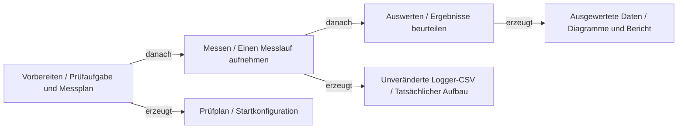
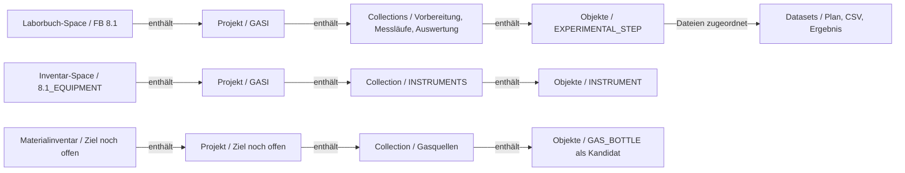
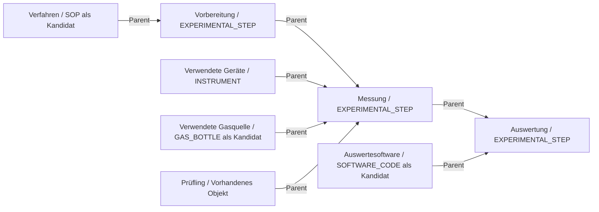

# GaSi: vom Prüfauftrag zum nachvollziehbaren Ergebnis

Dieses Konzept folgt den vier Schritten der [BAM-Anleitung](https://datastore.bam.de/en/openbis_20-10-12/how-to_guides/user_ui/represent_research_data).
Es beschreibt den **aktuellen Aufbau und künftige Messläufe**. Es erzeugt keine
Einträge in openBIS. Geräteidentität, bestätigter Einbau und Eignung als Referenz
sind getrennte Aussagen.

## 1. Draw the research workflow

**Vorbereiten → Messen → Auswerten.** Jeder Arbeitsschritt erzeugt eigene Dateien.
Geräte, Prüfling, Gase und Verfahren werden dafür wiederverwendet.

Was gehört zu den drei Arbeitsschritten?

| Tätigkeit | Was geschieht bei GaSi? | Eigene Ergebnisse / Dateien |
|---|---|---|
| Vorbereiten | Prüfzweck und Prüfling festlegen; eingesetzte Geräte, Gasquellen, Kanal- und Messortzuordnung prüfen; Messstufen und Bezugsbedingungen festlegen. | Prüfplan, Sollprofil und geprüfte Startkonfiguration. Nur wenn diese eigenständig aufbewahrt werden, eigener Arbeitsschritt. Sonst Teil der Messung. |
| Messen | Gasströme und gegebenenfalls Feuchte einstellen; Stufen durchlaufen; Referenz-, Prozess- und Prüflingssignale aufzeichnen. | Unveränderte Loggerdateien, tatsächlich verwendeter Lauf-Snapshot und gegebenenfalls Messprotokoll. |
| Auswerten | Gültige Zeitbereiche/Stufen auswählen; Soll, Referenz und Prüfling vergleichen; Korrekturen, Bedingungen und Unsicherheit dokumentieren. | Ergebnisdateien, Diagramme, Bericht sowie verwendeter Auswertecode mit Version. |

Ein Messlauf kann mehrere Dateien und Messstufen haben. Eine CSV-Zeile ist ein
Messpunkt, kein eigenes openBIS-Objekt. Wiederholte Auswertungen erhalten eigene
Auswertungsschritte und überschreiben weder Messdateien noch frühere Ergebnisse.

Die Gasmischung ist hier ein zeitabhängiger Prozesszustand im Lauf. Es wird kein
zusätzliches Probenobjekt für jedes Mischverhältnis oder Plateau erfunden. Ein
physisch entnommenes, weiterverwendetes Gas-/Materialmuster wäre ein neuer Fall.

Das Wiki, Abschnitt **1 Verfahrensprinzip**, belegt Prüfplan, Gasmischung,
Feuchteeinstellung und Signalerfassung. Die [Paper-SI](../data/paper/tg5c00105_si_001.pdf),
Abschnitt **1 Humidification unit**, belegt die methodische Trennung von Dosierung,
Befeuchtung und Referenzmessung; sie belegt keinen heutigen Einbau.
Der Logger und seine lokalen CSVs begründen die Trennung von Lauf, Stufe und Datei;
Feld- und Zeitregeln stehen im [detaillierten Datenmodell](GaSi_Datenmodell.md).

## 2. Identify Entities and Entity types

**Tätigkeiten:** Vorbereitung, Messung, Auswertung. 
**Verwendete Dinge:** Geräte, Prüfling, Gasquellen und versionierte Verfahren. 
**Ergebnisse:** Plan, Messdateien und Auswerteergebnisse.

Entitäten, Typen und notwendige Angaben anzeigen

„Bestätigt“ meint den dokumentierten Playground-Abgleich vom 12.11.2026,
keine erneute Live-Prüfung bei dieser HTML-Erzeugung. „Katalog“ bestätigt nur
die Sichtbarkeit eines Typcodes; Properties und Schreibrechte bleiben offen.

| Fachliche Entität | openBIS-Ebene / Typ | Minimalangaben und Belegstand |
|---|---|---|
| Vorbereitung, Messlauf, Auswertung | Je ein Objekt `EXPERIMENTAL_STEP` | Typ und Properties bestätigt. Fachlich: stabile Kennung, Zweck, Person, Beginn/Ende mit Zeitzone, verwendete Ressourcen. Drei Tätigkeiten benötigen keine drei neuen Typen. |
| MFC, MFM, Druckregler, Feuchtereferenz, Erfassung, weitere einzeln verwaltete Geräte | Inventarobjekt `INSTRUMENT` | Bestätigt; Hersteller, Modell, Seriennummer als belegte Identität; OE und Standort. Rolle und Position gehören zur Verwendung im Aufbau. Ein MFC ist kein MFM. |
| Prüfling / DUT | Vorhandenes `INSTRUMENT` wiederverwenden, wenn er ein verwaltetes Gerät ist; sonst `TEST_OBJECT` oder geeigneter `SAMPLE`-Typ prüfen | Letztere nur im Katalog bestätigt. Identität und Art klären. „Prüfling“ ist eine Rolle; das gleiche Gerät nicht zusätzlich als zweites DUT-Objekt anlegen. |
| Gasquelle / Flasche / Referenzmaterial | `GAS_BOTTLE`, gegebenenfalls passender Materialtyp | `GAS_BOTTLE` im Katalog; Properties noch nicht geprüft. Quelle/Charge, Zusammensetzung, Zertifikat und Gültigkeit bei Bedarf. Gasflasche, Betriebsmedium und dynamische Mischung unterscheiden. |
| Verfahrensvorschrift | `SOP` | Im Katalog; konkrete Version, Gültigkeit und Properties prüfen. Beim Vorbereiten referenzieren. |
| Softwareversion | `SOFTWARE_CODE` als wiederverwendbare Ressource | Im Katalog, Properties offen. Loggerstand zusätzlich im Mess-Snapshot, Auswertecode bei der Auswertung sichern; keine ausführbaren Geheimnisse einbetten. |
| Aktueller Aufbau | Zunächst Setup-Datei; `SETUP.TEST` nur als späterer Objektkandidat | Typ bestätigt, aber keine Geräte-/Kanalproperties. Geräteposition, Messort, Signalrolle und Gasweg im Snapshot; kein künstliches Gerüst aus neuen Typen. |
| Anlagen- und Modulübersicht | Gliederung des Aufbaus | Noch keine eigenen Objekte nötig. Physische Teil-von-Beziehungen sind keine automatisch festgelegten Parent-Beziehungen. |
| Geräte-Kalibriernachweis | `CALIBRATION`, soweit Pflichtangaben belegt | Typ und Pflichtfelder bestätigt. Verweis `INSTRUMENT` hat API-Datentyp `SAMPLE`. Nicht mit dem GaSi-Prüflingstest gleichsetzen. |
| Plan, Snapshot, Messprotokoll, Bericht | Dataset `ATTACHMENT` an der erzeugenden Tätigkeit | Typ/Assignments bestätigt. Datensatz kann mehrere zusammengehörige Dateien enthalten. |
| Unveränderte Loggerdateien | Dataset `RAW_DATA` an der Messung | Typ bestätigt. „Unverändert“ bedeutet Loggerexport; dieser kann bereits Softwarekorrekturen enthalten. |
| Berechnete Daten / Auswertecode / Diagramme | An der Auswertung; zunächst `ATTACHMENT` möglich | `ANALYZED_DATA`, `SOURCE_CODE` und `FIGURE` sind Katalogkandidaten. Vor Nutzung Assignments prüfen. Kein neuer Typ erforderlich, um den Ablauf zu besprechen. |

Herstellerunterlagen sind vorhandene Ressourcenbelege, keine von GaSi erzeugten
Messdaten. Sie bleiben in diesem Projekt lokal. Dafür wird kein erfundener
Forschungsschritt angelegt.

Finanzielle Anlagen-Inventarnummer, physische Geräteidentität, Geräteposition und
openBIS-ID werden getrennt geführt. Die Registrierung einer Identität bestätigt
weder ihren aktuellen Einbau noch Kalibriergültigkeit.

## 3. Map the research workflow

**Laborbuch:** die Tätigkeiten und ihre Dateien. 
**Inventar:** wiederverwendbare Geräte und Materialien.

Konkrete Ablage, Benennung und bestehende Ziele anzeigen

| Bereich | Geplante oder bestehende Ablage | Status |
|---|---|---|
| Dokumentierte Geräte | `/8.1_EQUIPMENT/GASI/INSTRUMENTS` | Bereits angelegt; zehn belegte Identitäten registriert. Kein Nachweis, dass alle aktuell eingebaut sind. |
| Echte Vorbereitung | `/<FB81_LAB>/GASI/PREPARATION` | Vorschlag, nicht angelegt; gemeinsames Laborbuchziel verbindlich auswählen. |
| Echte Messläufe | `/<FB81_LAB>/GASI/RUNS` | Vorschlag, nicht angelegt; keine Übernahme des persönlichen Testziels ohne Entscheidung. |
| Echte Auswertungen | `/<FB81_LAB>/GASI/ANALYSIS` | Vorschlag, nicht angelegt. Mehrere Auswertungen können dieselbe Messung verwenden. |
| Gasquellen | Freigegebenes BAM-/FB-Materialinventar, zunächst vorhandene Objekte suchen | Ziel und Pflichtfelder offen. Keine Space-/Collection-Codes erraten. |
| SOP / Software | Passendes bestehendes gemeinsames Inventar | Ablage und vorhandene Versionseinträge prüfen; keine Kopie pro Lauf. |
| Synthetischer Test | `/8.1_PNEUMANN/GASI_TEST/RUNS` und `/8.1_EQUIPMENT/GASI_TEST/INSTRUMENTS` | Bestehend und schreibend getestet; getrennt von echten Forschungsdaten. |

`<FB81_LAB>` ist ausdrücklich ein Platzhalter, kein ausführbarer Zielpfad.
Die bestehende Testfreigabe gilt nur für die konfigurierten Ziele; sie entscheidet
nicht über die Ablage echter Messläufe.

Eine Collection gruppiert Objekte; ihre Zugehörigkeit ist keine Parent-Beziehung.
Vorbereitung, Messung und Auswertung sind **Objekte**, keine Projects oder
Collections für einzelne Aufnahmen. Für einen anderen Prüfauftrag ist je nach
Umfang ein neues Projekt oder eine gemeinsame Projektgliederung möglich.

Anzeigenamen beispielsweise `GaSi – Messung – <Laufkennung>`; Codes sind davon
getrennte stabile Kennungen. Geräte behalten ihre Identität unabhängig von Position
und Bezeichnung. Eine Auswertung erhält eine eigene Kennung und referenziert die
unveränderten Eingabedatasets mit PermID und SHA-256.

## 4. Connect Entities

**Pfeile zwischen Objekten bedeuten Parent → Child.**
Die Dateien bleiben bei dem Arbeitsschritt, der sie erzeugt hat.

Die Kästen für Geräte und Gasquellen fassen mehrere mögliche Objekte zusammen.
Jedes tatsächlich verwendete Objekt wird einzeln verknüpft. Die Grafik zeigt
das Zielmodell; Notebook 05 testet bislang nur Instrument → Messlauf samt Dataset.

Verbindungsregeln und Mehrfachverwendung anzeigen

| Verbindung | Umsetzung und Bedeutung |
|---|---|
| Vorbereitung → Messung → Auswertung | Parent-/Child-Verknüpfungen zwischen `EXPERIMENTAL_STEP`-Objekten: Voraussetzungen und Datenherkunft. Falls Vorbereitung keine eigenen Ergebnisse erzeugt, in die Messung integrieren. |
| Gerät / Referenz / Gasquelle / Prüfling → Messung | Ressourcen sind Parents des Laufs. Nur tatsächlich verwendete Identitäten auswählen. Rolle, Messort, Kanal und Einsatzzeit im Snapshot dokumentieren; eine Parent-Kante enthält diese Angaben nicht. |
| SOP → Vorbereitung; Softwareversion → Auswertung | Versionierte Ressourcen als Parents. Die Messsoftwareversion wird im Lauf-Snapshot festgehalten; ein eigener geprüfter Softwareeintrag kann zusätzlich Parent der Messung sein. |
| Mehrere Messungen → eine Auswertung | Alle verwendeten Messungen als Parents; die exakten Eingabedatasets und ausgewählten Bereiche zusätzlich im Auswertemanifest. Parent-Beziehung allein identifiziert keine Datei oder Messstufe. |
| Eine Messung → mehrere Auswertungen | Jedes eigenständig gespeicherte Ergebnis hat seinen erzeugenden Auswertungsschritt. Keine Rohdatenkopie als neues Messergebnis. |
| Tätigkeit → Dataset → Datei(en) | Dataset-Zuordnung, keine Parent-/Child-Beziehung. Ein Ergebnisbericht hängt an der Auswertung; ein während der Aufnahme erzeugtes Messprotokoll an der Messung. |
| Collection → Objekt | Ablagezugehörigkeit, keine Objektkante. |
| CALIBRATION → Gerät | Typisierter Objektverweis `INSTRUMENT`, keine Parent-Kante. Ein Verweis ist im Hierarchiegraphen nicht automatisch wie eine Parent-Kante sichtbar. |
| Anlage / Modul / Position → Gerät | Fachliche Gliederung und Zuordnung im Setup. Noch keine festgelegte openBIS-Relation; nicht als bestätigte Parent-Kante darstellen. |

Mehrere Parents und mehrere Children sind zulässig (N:N). Pfeile beschreiben hier
Datenherkunft beziehungsweise Ressourcennutzung, nicht Gasströmungsrichtung,
Kabelverlauf oder zeitliche Rückkopplung. Der physische Aufbauplan ist eine andere Sicht.

Die BAM-Anleitung empfiehlt verbundene Objekte. Bereits registrierte Geräte ohne
Messlauf bleiben vorerst ohne Nutzungskante; dafür keinen künstlichen Messlauf
erzeugen. Beim ersten echten Lauf werden die verwendeten Geräte verbunden.

Was wurde korrigiert, was ist noch zu entscheiden?

| Punkt | Entscheidung / noch fehlende Information | Fundstelle |
|---|---|---|
| Auswerteergebnisse bisher direkt am Messlauf | Eigener Auswertungsschritt, wenn eigene Ergebnisse erzeugt werden. Ein bloßes Messprotokoll bleibt an der Messung. | BAM-Anleitung: **Core Concepts**, **1. Draw the research workflow**. |
| Hardwareübersicht als gesamter Forschungsablauf | Als ergänzende Aufbausicht behalten; Forschungsablauf separat aus Tätigkeiten und ihren Ergebnissen entwickeln. | BAM-Anleitung: Schritte **1–3**; Wiki: **1 Verfahrensprinzip**. |
| DUT pauschal als INSTRUMENT | Vorhandenes Geräteobjekt wiederverwenden oder Typ entsprechend Prüflingsart prüfen. | BAM-Anleitung: **2.2 Define Entity Types**; Katalogbefund `TEST_OBJECT` / `SAMPLE`. |
| Anlage, Module und Setup als zwingende neue Objekte | Zunächst Gliederung/Snapshot; eigene Objekte erst bei belegtem Nutzen und geeigneten Properties. | BAM-Anleitung: **Simplify your diagram**, **2.3 Reuse Existing BAM Object Types**; `SETUP.TEST`-Assignments. |
| Echte Laborbuchablage | Gemeinsam nutzbaren Space und Projektverantwortung auswählen; Vorschlags-Collections bestätigen. | Testbereich ist persönlich, nicht automatisch das Forschungsziel. |
| Prüfling, Gasflaschen, SOP und Software | Konkrete Identitäten/Versionen, vorhandene Einträge, Pflichtfelder und Rechte prüfen. Typkatalog reicht nicht. | Lokaler Playground-Befund; Notebook 04. |
| Aktueller Einbau und Kanalplan | Vor Ort bestätigen, welches Gerät an welcher Position bzw. welchem Messort betrieben wird. Sieben Identitäten bleiben offen. | Lokaler Gerätebericht; Notebook 02/06. |
| Erster echter Lauf | Laufgrenze, Zeitbasis, Messplan, zulässige Eingabewerte und Auswerteziel gemeinsam festlegen. Einbauenachweis und Referenzstatus sind laufbezogen zu bestätigen. | Detailliertes Modell: Messlauf und Messwerte. |
| Parser | Erst nach verbindlicher Lauf-/Datei-/Kanalzuordnung spezifizieren; kein bereits vorhandener GaSi-Parser aus dem Katalog ableitbar. | BAM-Parserseite verlinkt Beispiele und eine ETL-Anleitung; sie liefert keine GaSi-Feldzuordnung. |

**Stand:** Konzeptabgleich am 13.11.2026, offline gegen lokale Nachweise.
Keine neuen Live-Einträge und kein Upload echter Messdaten in diesem Schritt.
Die bestehenden Inventar- und synthetischen Testbefunde sind getrennt dokumentiert.

Quellen und weiterführende Links

- [BAM: Conceptual Data Model, Schritte 1–4](https://datastore.bam.de/en/openbis_20-10-12/how-to_guides/user_ui/represent_research_data), gelesen am 13.11.2026.
- [BAM: EuVSOP](https://datastore.bam.de/en/use_cases/euvsop), Abschnitte **Register data in the Lab Notebook** und **Connect Inventory and ELN**: getrennte Tätigkeiten mit Datasets, Ressourcen als Parents. Als Strukturvorbild verwendet, ohne dessen Forschungsobjekte oder Sondertypen auf GaSi zu übertragen.
- [BAM: Parsers](https://datastore.bam.de/en/parsers), Einstieg zu Beispielen, Workshop und ETL-Pipeline. Weitere Umsetzung nach Bestätigung der GaSi-Semantik.
- [GaSi-Wiki](../data/wiki/home.txt), **1 Verfahrensprinzip**, **Aufbau**.
- [GaSi-Paper, Supporting Information](../data/paper/tg5c00105_si_001.pdf), **1 Humidification unit**, insbesondere Figure S1 und Referenzmessung auf Seite 3.
- Betriebscode `logger/measurement_logger.py`, `communication/a5b.py` und `config/gas_flow_config.json`; nur lesend abgeglichener Betriebscode außerhalb dieses Repositorys.
- [Detailliertes Datenmodell und Instanzbefund](GaSi_Datenmodell.md), [synthetischer Live-Testnachweis](GaSi_Playground_Testnachweis.md). Gerätebelege, konkrete Kanalzuordnungen und Seriennummern bleiben lokal.

